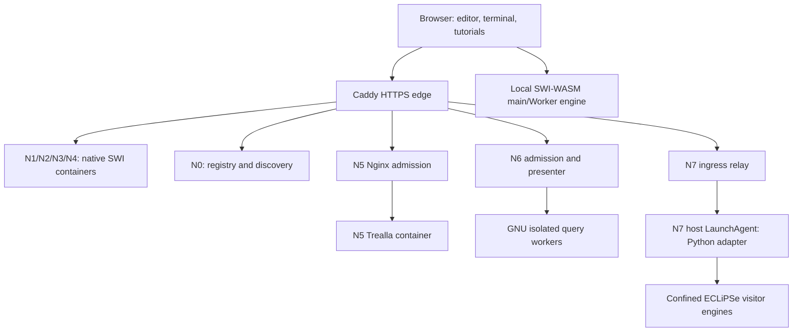

# Trinity demonstrator: project and operations handover

## Discovery self-description — 22 November 2026

Live selection after the 22 November release:

| Node | Runtime | Image |
|---|---|---|
| N0 | native SWI `67f0b17`, demonstrator `c5ebc76`, browser `1d6ee0d`; SWI-Prolog 11.0.0; `WP_DESCRIPTION` set | `b728c88d6eeb` |
| N1/N3/N4 | native SWI `67f0b17`, demonstrator `c5ebc76`, browser `1d6ee0d`; SWI-Prolog 11.0.0 | `8fc5c543fab8` |
| N2 | native SWI `67f0b17`, demonstrator `c5ebc76`, browser `1d6ee0d`; SWI-Prolog 11.0.0 | `bb85170bb902` |
| admin | native SWI `67f0b17`, demonstrator `c5ebc76`, browser `1d6ee0d`; SWI-Prolog 11.0.0 | `e1f380affa9e` |
| N5 | Trealla `edf2283`, 3.14.20; `WP_DESCRIPTION` set | `b3f82f901106` |
| N6 | trinity-demonstrator `c5ebc76` (adapter overlay) | `b86ec3b3aa9e` |
| N7 | eclipse-node `cbe235c` adapter, `bcc48cd0fd5e` worker | adapter `e00889c5e08f` |

Every node reports `implementation`, `version` and `description` in `/node_info`.
The Discovery Hub at `https://n0.elfenbenstornet.se/discovery-hub` queries
`node_directory_row/10` and shows all 8 nodes up with engine and description.

**Static assets** were not republished: the existing `uri-20261117` Caddy roots
already serve byte-identical runtime files and carry no provenance records. A
`package_demonstrator.py` build was staged and immediately rolled back after it
broke the node UIs (the tool produces a fully self-contained static site, not an
overlay for a live node's Caddy front-end). The node containers were not
affected by the rollback.

**Hub page** (`/discovery-hub`): Caddy serves this as a static file from
`deployment-caddy-1:/srv/trinity/portable-20261112-zsn664hr/hub/discovery-hub.html`.
That path lives only inside the `deployment_edge_assets` Docker volume — there
is no host-path backing it (`/srv/trinity` is a named volume, not a bind mount).
The file was replaced in-place with `web/discovery-hub.html` from `c5ebc76`,
which queries the new `node_directory_row/10` signature with `Implementation`,
`Version` and `Description`. No Caddy reload was needed (`Cache-Control: no-cache`).
A Caddy recreate would reattach the same `deployment_edge_assets` volume; the
modified file would survive. Replacing the volume or running `docker cp` from an
older source would restore the old hub page, which queries the old arity and
shows "Hub unreachable".

**WP_NET_ADDRESS_PLAN step 2** is now live: all six SWI containers carry static
`ipv4_address` pins in their candidate Compose models (admin `.2`, N1 `.3`,
N2 `.4`, N3 `.5`, N4 `.6`, N0 `.7`). `pids_limit` values were also carried.

Private operators: `.trinity/discovery-release-20261122/`: `n5/deploy_n5.py`,
`n7/deploy_n7.py`, `n6/deploy_n6.py`, `swi/deploy_swi.py` — each with
`--rollback`. Verification record:
`docs/verification/discovery-self-description-2026-11-22/`.

trealla-port `main` was **not** fast-forwarded: `main` still carries the
`7a8e8ce` receive-guard regression. N5 runs `edf2283` from the
`discovery-self-description` branch, which starts at `d451596`.

## Live conformance fixes — 21 November 2026

Live selection after the 21 November release:

| Node | Runtime | Image |
|---|---|---|
| N0–N4, admin | native SWI `9239028`, demonstrator `6fc9db8`, browser `4c784f9`; SWI-Prolog 11.0.0 | N0 `202f9cbe479b`, N1/N3/N4 `7759b23d172b`, N2 `d3836c21fa46`, admin `26ad505af769` |
| N5 | Trealla `d451596` (rolled back; see below), 3.14.20 | recovery `50f53bfd95e2` |
| N6 | gprolog-port `8eeb3f8` (= `91f21bd` + `94960dd`) | `8caf7235a7f4` |
| N7 | eclipse-node `a1aef63` worker and adapter (pin `9038bbb`) | adapter `de5c979bab1e`, worker `bcc48cd0fd5e` |

Static assets were not republished: all eight origins already serve byte-identical
runtime files, and the served trees carry no provenance records. OPEN access,
admission rates, credentials, mounts, networks and static addresses are preserved.

The [full sweep after the release](https://github.com/torbjornlager/trinity-conformance/blob/490ecfe/reports/2026-11-21-post-release-conformance/REPORT.md)
compares row by row with 20 November: 263 rows fixed, 129 still failing, 6 new
failures. The new failures are receive-guard controls RG-001..003/005..007 on
Trealla, introduced by trealla-port `7a8e8ce` (rpc maps the owner's execution limit
to `rpc_error(http_timeout)`, so abort, time limit and termination no longer
propagate through an rpc in an entered guard). **N5 was rolled back** to a qualified
recovery image equivalent to `d451596`, and the Trealla pin is back at `d451596`;
the N5 fixes (SR-015, rpc timeouts, `/call` `timeout`, localhost rpc) wait for a
trealla-port fix. N7 still fails PE-008 with an explicit limit plus timeout, and
`atom_codes(A,"ab")` because N7 reads `"ab"` as chars.

Deviations from the brief, qualification, the disk-full incident and rebuilt
recovery images are in the [deployment record](docs/verification/conformance-release-live-2026-11-21/REPORT.md).
Host cleanup removed the unused N5/N6/N7 predecessor images and older recovery
images; earlier releases' `rollback.py` commands that reference them will refuse
or fail. Private operators for this release are under
`.trinity/conformance-release-20261121/`: `n5/`, `n6/`, `n7/` and `swi/deploy_*.py
--rollback`, each scoped to its unit. N5's rollback is already applied.

**N5 addresses (17:14 UTC).** A Docker restart at 16:27 UTC left N5 admission
unable to start: a container without a fixed address had taken its `172.18.0.2`.
Docker gives such containers the lowest free address and doesn't reserve the
fixed address of a stopped container. Step 1 of
[the address plan](docs/WP_NET_ADDRESS_PLAN.md) is now live:

- `n5_admission` is on `172.18.0.12` and `oauth2_n5` on `172.18.0.13`. Images
  and settings are unchanged, and `compose.live.json` is updated.
- The six SWI containers still have dynamic addresses and fill `.2`–`.7` on
  a restart. Step 2 pins them at the next SWI release.
- Operator: `.trinity/n5-addresses-20261121/deploy.py --rollback`.

**Security hardening (evening).** A security review of the live system led to
deployment-side fixes. Every visible demonstrator example gave the same result
on N3, N4, N5 and N7 before and after. The review and its open items are kept
privately in `.trinity/security-review-20261121/`.

- Caddy, by graceful reload:
  - N0–N4 send HSTS, `nosniff` and a Referrer-Policy.
  - N5 `/metrics` is no longer public.
  - The N3/N4 `@trusted_internal_ws` routes are gone.
  - The N7→N3 peer bearer was rotated: the Caddy matcher and N7's
    `peer-0-out`, with the N7 adapter restarted.
- The unused `oauth2_n5` and `oauth2_n7` sidecars are removed (`oauth2_n5`
  also from `compose.live.json`), so the N5 address plan's `.13` is now
  free.
- Process limits were set with `docker update`:
  - N3/N4: 1024
  - N0, N1, N2 and admin: 512
  - Caddy and the N6 assets/hub: 256

  The Compose models don't carry them yet, so the next SWI or Caddy recreate
  must add `pids_limit`, together with step 2 of the address plan.

**N6 `src_uri` fix (22 November).** `rpc(…, [src_uri(…)])` on N6 failed with
`http_transport_error`. When a reply came with `Connection: close`, Python's
`http.client` closed the socket before the body was read, and the egress
broker's own reader then hit `EBADF`. Plain `rpc` worked only because `/call`
replies arrive in one packet. The fix in `Deployment/n6_egress.py` keeps the
socket open for the reader, and `tests/test_n6_egress.py` covers it.

- Live N6 runs a one-file overlay on the previous image: image `6330bcda1582`;
  rollback goes back to `8caf7235a7f4`.
- The rehearsal and the live switch both checked the two `src_uri` goals and
  N6's regression probes.
- Operator: `.trinity/n6-egress-fix-20261122/deploy.py --rollback`.

## Live canonical node identity — 20 November 2026

N0–N4 and admin select native SWI `254ae3a`, demonstrator runtime
`fd7e9f8` and browser provenance `b5ec41d`. N5 selects Trealla
`d451596`, including the preceding public clause-reflection repair.
SWI-Prolog remains 11.0.0 and Trealla 3.14.20. All twelve browser executable,
schema and engine-metadata payloads match the preceding package byte for byte.
N6, N7, ingress and Caddy retain their service/image selections. OPEN access,
admission rates, resource bounds, credentials, mounts and networks are preserved.

Canonical empty-root aliases share routing, credential and owner topology keys.
Non-root paths, ports, schemes and authorities stay distinct. Explicit URL calls
retain receiving contexts; ordinary names stay client-context scoped. Trealla
uses a separate peer connection cache per hosted client and reclaims it on
retirement, preserving the other client's actors and delivery.

Both CI jobs and all 36 local integration groups pass. Exact images pass 44 URI
assertions, two independent-peer reclamation controls, 45 ACTOR cases per runtime,
20 RPC timeout goals per runtime and all 136 visible OPEN exercise checks. Fresh
live checks pass 63 URI/context assertions across N3/N4/N5, 100 RPC timeout goals,
354 primary ACTOR cases, 30 anonymous parallel/fridge checks, 76 prompt assertions
and 700 sustained finite HTTP probes. See the [release report](docs/verification/canonical-uri-live-2026-11-20/REPORT.md).

The current conformance inventory has 183 unresolved failed observations. Nine
unchanged URI/source failure observations are repaired and deployed; fifteen
mixed address/visibility observations are superseded by the documented context
contract and its separate version 0.2 assertions. Original results remain intact.
This is a focused replay, not a new full sweep. N6/N7 and browser URI follow-up
remain separate work.

Current selection pointers identify the new frozen models. Private recovery is
under `.trinity/canonical-uri-release-20261120/release/`. Verify the exact selection:

`python3 .trinity/canonical-uri-release-20261120/release/rollback.py --check`

Omitting `--check` restores this release's predecessors. The guard refuses a newer
selection; earlier guards below are historical and refuse the current successors.
An isolated injected-failure rehearsal preserved its state marker. No production
rollback was needed.


## Previous RPC timeout validation — 20 November 2026

N0–N4 and admin select native SWI `0bf7286`, demonstrator runtime source
`ed70764` and browser provenance `ca8e689`. N5 selects Trealla `e99126b`.
SWI-Prolog remains 11.0.0; Trealla remains 3.14.20. Engine files, public OPEN
access, budgets, concurrency bounds, mounts and network settings are unchanged.
N6, N7, ingress and Caddy retain their prior service/image selections.

Both GitHub CI jobs and all 36 local integration groups pass. Fresh live
checks pass 100/100 unchanged RPC timeout assertions across N1–N5,
354/354 primary ACTOR cases across N3/N4/N5, 30/30 anonymous exercise checks,
76/76 HTTP prompt cases and 700/700 sustained finite HTTP probes. Both exact
runtime images pass the 45-case ACTOR gate and all 20 timeout goals. All 147
tracked root Prolog files on N5 match its committed source. The browser's
12 executable/schema/engine-metadata files match their predecessors.

The [deployment report](docs/verification/rpc-validation-live-2026-11-20/REPORT.md)
retains source/image identities, fixture setup errors and passing qualification.
The conformance inventory closes 30 repeated timeout failure observations;
211 failed observations remain unresolved, rather than 211 proven defects.
URI routing/source transfer is the next queue. Historical sweeps are unchanged.

Canonical selection and both SWI/N5 pointers now identify this release.
Recovery inputs remain private under `.trinity/rpc-validation-release-20261120/release/`:

`python3 .trinity/rpc-validation-release-20261120/release/rollback.py --check`

Omit `--check` to recover this exact release only. The guard refuses newer
container or host selections. The old retirement guard below is historical
and intentionally refuses the current successors. No production rollback
was needed; an isolated injected-failure rehearsal preserved its state marker.


## Previous actor retirement repair — 20 November 2026

N0–N4 and the private admin now select native SWI `0c11f2c`, demonstrator
`8318918` and browser package `b2fd3fe`. SWI remains 11.0.0. Engine bytes and
all 12 browser executable/schema/engine-metadata files are unchanged; the
browser pin updates schema provenance. Trealla, GNU, ECLiPSe, ingress and
Caddy retain their preceding selections. Access stays OPEN on public nodes,
with the existing admission and concurrency bounds.

Actor PID mappings now retire before monitor notification delivery. Both
GitHub CI jobs pass. The deterministic regression passes in every exact
candidate image, and the private ACTOR gate passes 45/45. Live N3/N4 each
pass all 118 primary ACTOR cases and 100 unchanged NU-003 repetitions.
The live smoke run also passes 30 anonymous exercise checks, 57 HTTP prompt
cases, 560 sustained finite HTTP requests, context isolation, Linda,
discovery and cross-runtime consumer checks. One initial local WASM worker
cleanup failure is retained alongside four passing focused controls and a
passing full WASM recheck; its precise cause remains unproven.

The [deployment record](docs/verification/actor-retirement-live-2026-11-20/REPORT.md)
contains source/image identities and fresh evidence. Configuration, credentials,
volumes, read-only payloads, networks and resource bounds were preserved.
Canonical `Deployment/compose.live.json` and `.trinity/live-swi-current.json`
select the new models; the N5 pointer is unchanged. Recovery inputs are under
`.trinity/retirement-release-20261120/release/`. Check the exact selection with:

`python3 .trinity/retirement-release-20261120/release/rollback.py --check`

Omit `--check` only for explicitly requested recovery of this release. The
guard refuses a changed selection. Keep predecessor images, private models
and data volumes available. Earlier SWI recovery instructions below are
historical and do not identify the current selection. The conformance
follow-up is focused deployment verification; earlier full-sweep findings
remain open unless explicitly resolved in the new record.

## HTTP contexts and OPEN release — 19 November 2026

The production pins and live services now select native SWI `a2ff186`, Trealla
`3a5b761` and browser package `ce96659`; the deployed demonstrator source is
`2b58804`. N0–N4, admin and N5 were replaced with qualified immutable images.
SWI remains 11.0.0, Trealla remains 3.14.20 and the browser engine remains
10.1.19. The browser package changes native schema provenance only.

Fresh HTTP requests isolate promise ownership, including requests with equal
credentials. Cross-query sharing uses an explicit retained session; OPEN needs
no login. The native lifecycle repair preserves the creating node's retirement
context and repairs linked-child teardown. All 136 checks across the 34 visible
OPEN entries passed with the production pins. Both CI jobs, all 34 local
consumer groups, all five packaged browser groups, and each exact image's
45-case ACTOR gate passed. The live smoke run includes HTTP/session isolation,
30 parallel/fridge queries across N3/N4, naming/lifecycle, Linda, discovery and
SWI/Trealla/ECLiPSe consumer interoperability.

The [deployment report](docs/verification/http-context-live-2026-11-19/REPORT.md)
records source/image identities, smoke observations and preservation checks.
Current frozen models and recovery inputs are under
`.trinity/http-context-release-20261119/`; the existing SWI/N5 selection pointers
and canonical `Deployment/compose.live.json` identify those models. Node settings,
credentials, data volumes and read-only peer/owner payloads were preserved.
Caddy and the N6/N7 runtimes were not replaced.

For explicitly requested recovery, use
`python3 .trinity/http-context-release-20261119/rollback.py`. It checks the exact
selected container identities, host selections and sealed operator inputs before
restoring the captured predecessors. Its `--check` option is read-only. Keep
these images, private models and data volumes available. Earlier release entries
below describe historical predecessors and are not current recovery shortcuts.

## Live N5 client-context naming — 19 November 2026

N5 now runs `trealla-port` **6041ea3**, with ordinary names scoped to each client
context and explicit published services remaining node-wide. The Trealla engine
is unchanged at 3.14.20. All eight live naming checks and all eight smoke groups
passed, including 36 versioned case executions, Linda across independent clients,
N5→N3 interoperability, N1 source loading and N2→N4 nested RPC. Both GitHub CI
jobs and all 34 local integration groups passed for consumer commit `33ca0d9`.

The [verification record](docs/verification/n5-client-naming-2026-11-19/verification.json)
identifies the selected image, source files, recovered smoke-runner error and
preservation checks. All other persistent services retained their container and
image identities. N5's credentials, settings, mounts, peer files, network identity
and limits were preserved; Caddy was unchanged.

The selected N5 model is
`.trinity/n5-naming-release-20261119-r2/candidate.compose.private.json`, project
`deployment`, service `wp_n5`. `.trinity/live-n5-current.json` and
`Deployment/compose.live.json` now describe that selection. The captured running
predecessor was used for recovery, correcting stale image/healthcheck information
in the older canonical model. Original models and the first automatically rolled
back attempt remain private and intact.

For an explicitly requested recovery of this release, run
`python3 .trinity/n5-naming-release-20261119-r2/rollback.py`. It refuses a different
successor image and preserves the other services. The clean detached checkout
`.trinity/naming-release-20261119-native` backs local native startup at the
unchanged SWI pin `26e1ce7`; keep it until replacing it with another validated
checkout. The separately published SWI cleanup fix `dc93b05` is not deployed by
this N5 release.

## Trealla naming pin — 19 November 2026

The development dependency now selects `trealla-port`
`6041ea36bfeec553f9888b770cb47e7759c2c9cb`. Ordinary actor names and startup
reservations are client-context scoped, matching SWI; published services remain
node-wide. The engine remains Trealla 3.14.20 at its existing exact pin.
The [shared naming qualification](https://github.com/torbjornlager/trinity-conformance/blob/2bbf2b522d77204453739df02665852a7036d83e/reports/2026-11-19-client-naming/REPORT.md)
records 8/8 on SWI, patched Trealla and ECLiPSe, plus seven applicable checks in
each browser mode. All 106 native unit groups and 69 interoperability groups
passed. This pin commit does not itself select a live image; the live SWI image
selection and native SWI dependency below remain unchanged.

## Live SWI deployment — 19 November 2026

N0–N4 and the local admin node now run **SWI-Prolog 11.0.0** with native
`swi-prolog-node` commit `26e1ce7` and demonstrator commit `dc66d8c`.
All 22 live smoke groups passed, including 109 conformance cases, HTTP visitor
ownership, discovery, Linda, N3→N4 actor interoperability, and N5/N7→N1 source
transfer and →N2→N4 nested RPC. The ARM64 candidate native suite also passed.
Every live engine tree matched all 1,536 files in the official 11.0.0 image.
N5, N6, N7, Caddy and authentication containers retained their identities and
images; existing volumes, credentials and node security settings were preserved.

The [deployment record](docs/verification/swi-11-live-deployment-2026-11-19.json)
contains exact images, qualification, recovered preparation errors and results.
Private frozen models, logs and rollback inputs are retained under
`.trinity/live-swi11-20261119-release/`. The ignored
`.trinity/live-swi-current.json` names the exact selected per-service models;
`Deployment/compose.live.json` now also contains the selected SWI service models.
For a scoped recreate, use the selected frozen model with its recorded project,
`--no-build --pull never --no-deps` and the specific service. Older deployment
models and source/version inventories below are historical predecessors.

An explicitly requested recovery of this release uses
`python3 .trinity/live-swi11-20261119-release/rollback.py`; it restores the six
captured predecessor images/configurations and the prior host selection files.
It rejects services that have moved to a different successor image. Inspect the
current selection before invoking recovery; this is not a general redeploy tool.

## Native SWI baseline update — 19 November 2026

The development checkout now selects native `swi-prolog-node` commit
`26e1ce7d712afafe440e3f87388baec4490232ec` and requires threaded SWI-Prolog
11.0.0 or newer. CI and the two native SWI Dockerfiles pin 11.0.0 with verified
source/archive and image-index checksums. The browser package's schema provenance
is aligned through companion commit `0363b38b3d4939a53f62a57b23fbc4e73997e79f`;
its schema bytes and WASM engine (10.1.19) are unchanged.
See the [upgrade verification](docs/verification/swi-11-upgrade-2026-11-19/REPORT.md)
for the test results. These source updates do not rebuild or restart public
services. Older engine/version inventories below remain historical deployment
records; current local native startup requires 11.0.0.

## Current N7 management: Docker Compose — 16 November 2026

The public N7 adapter now runs as `deployment-wp_n7-1`, service `wp_n7` in the
`deployment` Compose project. Its main host LaunchAgent and standalone ingress
relay were removed. Isolated ECLiPSe workers retain the previous engine image,
non-root user, disabled networking, read-only root, limits and no host mounts.

From `/Users/lager/trinity-demonstrator`, use:

```sh
docker compose -p deployment -f Deployment/compose.n7.yaml restart wp_n7
```

The private `Deployment/compose.live.json` captures the actual deployment project,
including N7, and supports a project-wide `restart`. N0/N6 keep their existing
separate projects. Caddy's existing configuration/assets now persist in Docker
volumes, and its direct loopback listener replaces the relay. The shared host
TLS router was not changed. Earlier LaunchAgent/relay cutover instructions in
this dated handover are historical; see the
[migration record](docs/verification/n7-compose-migration-2026-11-16.json) for
current identities, verification and retained recovery inputs.

**Prepared: 15 November 2026.** This is a point-in-time handover for the existing
`elfenbenstornet.se` deployment and the development machine owned by Torbjörn
Lager. Paths below are absolute paths on that Mac. GitHub repositories provide
source history; ignored `.trinity/` directories hold local packages, private
operator inputs and substantial verification evidence. Those directories are
not automatically reproduced by cloning Git.

This handover was prepared through read-only inspection and documentation edits.
It does not authorize, perform or imply another deployment. Commands that change
services are explicitly separated from inspection and testing commands.

## Scoped update: published counter access — 16 November 2026

N7 now routes published remote service messages, so the ACTOR tutorial's
`counter@'https://n3.elfenbenstornet.se' ! count(Self)` query works from both
N7 and N5. N5 was not restarted. The tutorial timeout uses
`writeln('Service not available.')` on all eight origins.

The selected N7 successor is
`/Users/lager/eclipse-node/.trinity/releases/n7-named-services-20261116-final`.
Its predecessor is the public `n7-sandbox-20261116-b29a5ad-candidate` release;
the earlier release inventories below remain dated historical information.
Service catalogs are unchanged: this repairs access to N3's resident counter.
The [deployment record](docs/verification/named-service-counter-deployment-2026-11-16.json)
contains exact identities, qualification, live checks and scoped rollback.

## Contents

1. [Current state and first actions](#1-current-state-and-first-actions)
2. [Project purpose and ownership](#2-project-purpose-and-ownership)
3. [Repository and resource map](#3-repository-and-resource-map)
4. [Deployed nodes and URLs](#4-deployed-nodes-and-urls)
5. [Architecture and language contracts](#5-architecture-and-language-contracts)
6. [Exact deployed selections and provenance](#6-exact-deployed-selections-and-provenance)
7. [Development setup](#7-development-setup)
8. [Tests and how to interpret them](#8-tests-and-how-to-interpret-them)
9. [Deployment preparation](#9-deployment-preparation)
10. [Cutover, verification and rollback](#10-cutover-verification-and-rollback)
11. [Open issues and unqualified areas](#11-open-issues-and-unqualified-areas)
12. [Investigations and resolved incidents](#12-investigations-and-resolved-incidents)
13. [Evidence index](#13-evidence-index)
14. [Recommended next work](#14-recommended-next-work)
15. [Operational checks and troubleshooting](#15-operational-checks-and-troubleshooting)

## 1. Current state and first actions

The currently selected coordinated group is:

`/Users/lager/eclipse-node/.trinity/coordinated-releases/signal-20261115-4045bf5-r2`

Its manifest SHA256 is:

`c81a7d3d3f77ea93236b367c19a7d656884a8e401a3c928ae938af3e6fcaa238`

The release deploys the Trealla native cancellation safeguard and the shared
Examples/tutorial visibility changes. N5 and N7 are public. **Do not restore
owner-only access or an N7 sign-out button based on older documents.** N7's
canonical UI is [https://n7.elfenbenstornet.se/demonstrator](https://n7.elfenbenstornet.se/demonstrator).
The former `/n7-shell/` UI address is obsolete.

The last full deployed audit, performed on 15 November after this release,
reported **zero unexpected failures in the visible material**:

- All eight catalogs were freshly fetched: 472 retrievals, including retained
  hidden source files and the retired SWI-WASM tutorial pointer.
- Visible Prolog examples 01–20 and SXML examples 01–14 were exercised on the
  applicable execution profiles, together with the supported tutorial chapters.
- SWI-WASM main and Worker modes passed the browser example/tutorial checks.
- All 72 browser runtime asset comparisons matched across the eight origins.
- Output, return messages and correlated prompts passed all 12 directed pairs
  among N3, N4, N5 and N7: 36 checks, with no peer-check watchdog expiry.
- The N7-served closure example produced the complete six-edge closure exactly
  once in both browser modes.
- Browser API results were 16 passes, 10 intentional unsupported-profile
  messages and six intentional unavailable-service messages.
- The report counts 2,838 list records; that is a mixed observation count,
  **not** a count of independent language conformance requirements.

Full report:
[/Users/lager/eclipse-node/.trinity/deployed-audit-20261115-dd5_70wp/results/report.json](/Users/lager/eclipse-node/.trinity/deployed-audit-20261115-dd5_70wp/results/report.json).
Read its exclusions: hidden model/Jev/Linda experiments were outside the main
execution sweep. A retained bounded completed-chart regression still exercised
the final four steps of hidden service-request chart 18. No external model/Jev
provider was invoked by that sweep.

Preservation checks confirmed unchanged persistent service identities/images/
configuration, N7 LaunchAgent/process, proxy configuration, repository refs,
stashes, preview/snapshot refs, 27 existing N7 package inventories and 37
coordinated release inventories. Public visitor-engine creation and disposal
are expected execution activity, excluded from persistent-service identity
comparisons.

**The main confirmed runtime follow-up is separate:** Trealla can hang during
ordinary failing source initialization, demonstrated with `src_text(':- fail.')`.
An attempted startup-acknowledgement repair was not qualified and was excluded
from the deployed cancellation fix. See [section 11](#11-open-issues-and-unqualified-areas).

First actions for a new maintainer:

1. Read this document, the active ECLiPSe handover and the selected release's
   manifest, operator and rollback procedure.
2. Inspect Git status in every repository before editing. Preserve other work.
3. Inspect the actual LaunchAgent, image IDs and proxy selections privately.
   Do not assume a working-tree branch is what production executes.
4. Determine whether the task affects content, a runtime, owner-installed
   services, transport configuration or more than one of these.
5. Work in the owning source repository. Test the affected boundary, commit/pin
   it when preparing a release, then create a new package. Do not edit a sealed
   predecessor to make a test pass.

## 2. Project purpose and ownership

Trinity demonstrates **Web Prolog** across several Prolog engines and execution
profiles. The shared language includes ordinary Prolog queries, HTTP result
paging, session toplevels, actor messaging, reusable behaviours, distributed
execution, RPC/promises and SXML statecharts. The portal supplies an editor,
terminal, node selection, tutorials, example loading, logging/trace views and
API demonstrations.

`trinity-demonstrator` owns the user-facing application and its deployment
integration. It no longer owns the native SWI implementation or the browser
runtime implementation. Its README calls the project pre-release: successful
public operation and scoped tests do not amount to a complete language,
security or production certification.

| Concern | Owning source |
|---|---|
| Portal/editor/terminal presentation, node cards and buttons | `trinity-demonstrator/web/demonstrator.html`, presenter JS under `web/vendor/` |
| Shared tutorials and manual served by the demonstrator | `trinity-demonstrator/web/` |
| Client programs and SXML examples | `trinity-demonstrator/examples/` |
| Portable JSON client codec and host adapters | `examples/portable_json.pl`, `examples/portable_json_swi.pl` |
| Owner-installed counter, pubsub, Linda, model/Jev integration | `examples/services/`, deployment bootstrap files |
| Shared example databases and per-node overlays | `trinity-demonstrator/Deployment/shared_db_*.pl` |
| Native SWI actor/node/runtime semantics | `swi-prolog-node/prolog/web_prolog/` |
| SWI-WASM runtime/coordinator/Worker semantics and runtime tests | `swi-wasm-node/` |
| Trealla Web Prolog port and native-control safeguard | `trealla-port/` |
| GNU ISOBASE implementation | `gprolog-port/isobase/` |
| GNU presenter, containment and deployment integration | `trinity-demonstrator/Deployment/n6_*.py`, related tools/Compose files |
| ECLiPSe runtime, Python HTTP/WebSocket adapter and release tooling | active `eclipse-node` worktree, especially `experiments/eclipse-clp/` and `tools/` |
| Engine-independent observable test contracts | `trinity-conformance/` |

The guidance in
[/Users/lager/trinity-demonstrator/CLAUDE.md](/Users/lager/trinity-demonstrator/CLAUDE.md)
is particularly relevant: implementation fixes and implementation tests belong
upstream; do not recreate a second native runtime or SXML schema in the
consumer repository. Keep lower-layer tests independent of the complete node.
Record intentional observable semantic changes in `DEVIATIONS.md`.

## 3. Repository and resource map

### 3.1 Checkouts, branches and revisions

These are the inspected **development checkouts**, not a claim that all services
were rebuilt from their HEADs.

| Repository | Local directory | Branch / HEAD at handover |
|---|---|---|
| [trinity-demonstrator](https://github.com/torbjornlager/trinity-demonstrator) | `/Users/lager/trinity-demonstrator` | `main`, `82468e1bc7c23c1a4be265d83137af3c15ed9318` before this documentation edit |
| [swi-prolog-node](https://github.com/torbjornlager/swi-prolog-node) | `/Users/lager/swi-prolog-node` | `codex/welcome-release-20261113`, `6fb82d5ca9de864199400ddb5119d43503566e97` |
| [swi-wasm-node](https://github.com/torbjornlager/swi-wasm-node) | `/Users/lager/swi-wasm-node` | `main`, `539a01c30165359bca3a19a83a09b7a5c8d632aa` |
| [trealla-port](https://github.com/torbjornlager/trealla-port) | `/Users/lager/trealla-port` | `main`, `09dd226115b9d6756995401943d9178e75c119db` |
| [gprolog-port](https://github.com/torbjornlager/gprolog-port) | `/Users/lager/gprolog-port` | `main`, `0fb95dbff83ac23ff0640518680145399587664d` |
| [eclipse-node](https://github.com/torbjornlager/eclipse-node), canonical checkout | `/Users/lager/eclipse-node` | `main`, `0961eaffbc956ac6238e45a1f9929f523850b0a0` |
| Same ECLiPSe repository, **active release worktree** | `/Users/lager/.codex/worktrees/n7-http-output/eclipse-node` | `codex/portable-json-deployment-20261113`, `3a35b17` deployment-record commit |
| [trinity-conformance](https://github.com/torbjornlager/trinity-conformance) | `/Users/lager/trinity-conformance` | `main`, `34557d322518941ba13a3e4486736e3d41d73c81` |

The canonical ECLiPSe `main` checkout is **not** the current deployment source.
It preserves older security development and historical checks. It was pushed
on `codex/security-source-checkpoint-20261115` after `main` rejected a
non-fast-forward push; no force push or history replacement was performed.
Do not deploy that older checkpoint over current public N7.

Another retained ECLiPSe worktree is
`/Users/lager/.codex/worktrees/n7-adapter-prerequisites/eclipse-node`, detached at
`020534d`. It is preserved historical work, not the active release checkout.
Use `git worktree list` before choosing a checkout; do not remove worktrees,
branches, tags, stashes or saved snapshots as an incidental cleanup step.

### 3.2 Dependency pins and caches

The shared repository's `dependencies/` files pin source commits and, where
applicable, engine commits and package hashes:

- Native SWI: `6fb82d5…`; Web Prolog pack name remains `web_prolog`.
- Browser runtime: `539a01c…`, version `0.1.0`, package manifest SHA256
  `58d17939633a3fa68e2fba5353bda8b58f0b8c3c8b8b996fc20ce6b847bb4664`.
- SWI-WASM engine: npm package `swipl-wasm` `8.2.5`, SWI engine `10.1.19`,
  engine commit `724df2b54cf1dda6fb3327d9167db2ae750c460e`.
- Trealla port: `09dd226…`; engine `3.14.20` at
  `841f819c7dbd462d053a8e0cafb51cd168c9cf7c`.
- GNU **future-build pin**: port `1f2077294850da1bca476df7e97b2e52b23bbb59`,
  engine `1.6.0` at `5976ac516c9fbd1d740d41b238597e327302baea`.
  The existing N6 image instead records port `94960dde7c97891f78f30aad1f0e59b9f58f7709`.
  The local GNU HEAD is different again. These are separate facts; do not
  rebuild N6 casually as part of a shared-content change.

The browser package pins the native schema provenance too. Its native/schema
revision is `6fb82d5…`, with SXML schema SHA256
`968c0cc1dd4358e59d0d7ae6bc660299ef234e8b97616aeead154bdd697ff592`.
Coordinate schema-dependent native/browser pin changes.

The active ECLiPSe checkout pins the shared demonstrator at `82468e1…`.
Its dependency names have different jobs:

| ECLiPSe dependency file | Job |
|---|---|
| `demonstrator.json` | selected shared UI/examples package |
| `runtime-contracts.json` | newer common conformance runner, `34557d3…` |
| `conformance.json` | dedicated older packaged-N7 harness, `475b799…` |
| `peer-native.json` | isolated SWI peer fixture, `4504fc2…` |
| `manual.json` | historical shared source pin `0ae08b8…`, not a separately maintained manual checkout |
| `eclipse.json` | ECLiPSe `7.2_13`, Linux ARM64 distribution URL and checksum |

Do not replace all these revisions with one repository HEAD. The prompt-reference
runner mismatch was fixed by respecting the newer runner's contract while
retaining the separate packaged harness.

Important ignored caches:

- Shared consumer: `/Users/lager/trinity-demonstrator/.trinity/`, including
  validated native setup and assembled browser packages.
- Active ECLiPSe worktree: `.trinity/n7-extraction/`, with `deps/`, owned
  Python environment and distribution archive. In that worktree this path is
  a symlink to `/Users/lager/eclipse-node/.trinity/n7-extraction`; the
  worktree holds no separate copy.
- Canonical ECLiPSe directory: `/Users/lager/eclipse-node/.trinity/`, containing
  the current releases, coordinated groups and most investigation evidence.

The shared consumer cache and the ECLiPSe store are different directories.
The active worktree's only `.trinity` entry is the `n7-extraction` symlink, so
removing or moving the canonical `.trinity/n7-extraction` breaks the active
worktree's setup.

### 3.3 Files a maintainer is likely to edit

| File/directory | Purpose |
|---|---|
| `/Users/lager/trinity-demonstrator/web/demonstrator.html` | portal, node selection, drawer filters and tutorial links |
| `/Users/lager/trinity-demonstrator/web/tutorial.html` | general tutorial |
| `/Users/lager/trinity-demonstrator/web/actor-profile-tutorial.html` | ACTOR tutorial, shared across engines |
| `/Users/lager/trinity-demonstrator/web/actor-api-tutorial.html` | raw actor protocol lab and toplevel API examples |
| `/Users/lager/trinity-demonstrator/web/isobase-*-tutorial.html` | ISOBASE tutorial/API pages |
| `/Users/lager/trinity-demonstrator/web/isotope-*-tutorial.html` | ISOTOPE tutorial/API pages |
| `/Users/lager/trinity-demonstrator/web/manual.html` | shared served language reference |
| `/Users/lager/trinity-demonstrator/examples/actors/` | numbered Prolog examples |
| `/Users/lager/trinity-demonstrator/examples/statecharts/` | numbered SXML examples |
| `/Users/lager/trinity-demonstrator/examples/APIs/` | runnable HTTP and WebSocket HTML examples |
| `/Users/lager/trinity-demonstrator/examples/services/` | owner-installed services and portable client helpers |
| `/Users/lager/trinity-demonstrator/Deployment/` | image recipes, launchers, proxy/Compose templates, example databases |
| `/Users/lager/trinity-demonstrator/tools/` | dependency setup, packaging and consumer/integration tests |
| `/Users/lager/.codex/worktrees/n7-http-output/eclipse-node/experiments/eclipse-clp/` | ECLiPSe runtime and Python adapter |
| `/Users/lager/.codex/worktrees/n7-http-output/eclipse-node/tools/` | N7 packaging, recovery, cutover, public checks and timed audit client |

`web/swi_wasm_actor_worker.js`, `web/swipl-bundle.js`, selected vendor assets and
`prolog/web_prolog/wasm/statechart_*.pl` use tracked symlinks into the validated
browser package. Do not replace them with copied runtime files. The consumer's
browser shared example database is `prolog/web_prolog/wasm/shared_db.pl`.

## 4. Deployed nodes and URLs

| Node | Implementation / profile | Public UI | Other useful public URL |
|---|---|---|---|
| N0 | discovery hub, narrow `relation` profile | [N0 demonstrator](https://n0.elfenbenstornet.se/demonstrator) | [Discovery Hub](https://n0.elfenbenstornet.se/discovery-hub) |
| N1 | native SWI, `isobase` | [N1 demonstrator](https://n1.elfenbenstornet.se/demonstrator) | [ISOBASE tutorial](https://n1.elfenbenstornet.se/isobase-profile-tutorial) |
| N2 | native SWI, `isotope` | [N2 demonstrator](https://n2.elfenbenstornet.se/demonstrator) | [ISOTOPE tutorial](https://n2.elfenbenstornet.se/isotope-profile-tutorial) |
| N3 | native SWI, `actor` | [N3 demonstrator](https://n3.elfenbenstornet.se/demonstrator) | [ACTOR tutorial](https://n3.elfenbenstornet.se/actor-profile-tutorial) |
| N4 | second native SWI, `actor` | [N4 demonstrator](https://n4.elfenbenstornet.se/demonstrator) | [ACTOR tutorial](https://n4.elfenbenstornet.se/actor-profile-tutorial) |
| N5 | Trealla, `actor` | [N5 demonstrator](https://n5.elfenbenstornet.se/demonstrator) | [ACTOR tutorial](https://n5.elfenbenstornet.se/actor-profile-tutorial) |
| N6 | GNU Prolog, contained public `isobase` | [N6 demonstrator](https://n6.elfenbenstornet.se/demonstrator) | [ISOBASE tutorial](https://n6.elfenbenstornet.se/isobase-profile-tutorial) |
| N7 | ECLiPSe Prolog `7.2.13`, isolated public `actor` | [N7 demonstrator](https://n7.elfenbenstornet.se/demonstrator) | [ACTOR tutorial](https://n7.elfenbenstornet.se/demonstrator/actor-profile-tutorial.html) |
| SWI-WASM | local browser engine, main and Worker modes | select SWI-WASM in the demonstrator | shares the ACTOR tutorial; separate WASM walkthrough is retired |

All eight nodes advertised `auth=open` in the fresh audit. This does **not**
mean N0 permits arbitrary Prolog: its relation profile restricts `/call` to
advertised relation patterns. Nor does it make N6 an ACTOR node.

For any node, `/node_info` is the useful first metadata check. N7's returned
implementation string may still say `ECLiPSe CLP`; the user-facing link label is
**ECLiPSe Prolog**. The metadata string is not evidence of an old UI deployment.

### 4.1 Routes and public assets

| Profile | Execution routes |
|---|---|
| `relation` | `/call`, restricted to advertised relations |
| `isobase` | `/call` |
| `isotope` | `/call`, `/toplevel_*` session operations |
| `actor` | the above, plus `/ws` actor transport |

N0–N6 normally expose tutorial pages through extensionless routes such as
`/tutorial`, `/actor-profile-tutorial` and `/actor-api-tutorial`. Do not replace
these with `.html` paths in an audit: those native catalog paths return 404.
N7 static tutorial/runtime assets live beneath `/demonstrator/`, for example
`/demonstrator/tutorial.html` and `/demonstrator/examples_index.json`.
N7 execution still uses root `/call`, `/toplevel_*` and `/ws` routes.

Current source inventories are `/examples_index` on N0–N6 and
`/demonstrator/examples_index.json` on N7. Use the returned encoded URLs;
filenames contain spaces. Keep encoding of source URLs separate from HTML
route aliases.

The deployed resident service catalogs were:

- N0: `registry`.
- N3/N4: `counter`, `linda`, `pubsub_service`.
- N5: `linda`.
- N1/N2/N6/N7: no advertised resident services.

A service-dependent API example must explain an absent service. It must not
invent a service on another node or silently substitute a different node.

### 4.2 Deliberately hidden and retired content

Shared commit `5cafebd83ee643f200f67a31190fcff8368abfad` temporarily hides:

- Tutorial service-policy and statechart-service-request sections.
- The Jev agent experiment entry/link.
- Prolog drawer examples 21–25.
- SXML drawer examples 15–20.

The source remains in Git and available in deployed catalogs. The main drawer
switch is `HIDE_EXPERIMENTAL_EXAMPLES` in `web/demonstrator.html`; tutorial
sections use hidden wrappers and the table of contents omits hidden headings.
Re-enabling requires deliberate source edits, review of service prerequisites,
new package preparation and verification. Do not edit a live page in place.

`web/swi-wasm-tutorial.html` is a retired pointer to the shared tutorial. Its
old standalone `respond/2` walkthrough is not the current SWI-WASM teaching
material and should not be resurrected by an old audit runner.

## 5. Architecture and language contracts

### 5.1 Deployment shape



The Mac runs Docker Desktop, whose Linux VM hosts the containers. N7 also has
an adapter process managed by a macOS LaunchAgent; it is not operated by simply
rebuilding `Deployment/compose.yaml`. N6 and N0 use separate Compose projects.
Only the intended edge/local admin bindings should be host-exposed.

N5 path: TLS/Caddy → `deployment-n5_admission-1` → `deployment-wp_n5-1`.
A failure before HTTP101 is a different stage from a WebSocket welcome timeout.
The audit client records them separately.

N7 adapter LaunchAgent:

`/Users/lager/Library/LaunchAgents/se.elfenbenstornet.trinity-n7-adapter.plist`

Its current backend port is `18087`. Its Python executable, adapter path,
working directory and shell assets point into the selected immutable N7
package. Its engine image is separately pinned. Its public origin is
`https://n7.elfenbenstornet.se` and its arguments include `--public`.

N7 public sessions use confined visitor engines with no host bind mounts or
visitor access to peer credentials; isolated qualification verifies non-root,
read-only, network-disabled workers and resource limits. Internal peer transport
is a separate trusted path. Public visibility does not expose the adapter's
proxy token or turn internal headers into anonymous authority.

### 5.2 Runtime layers

The native SWI design consists of independently loadable layers connected by
hooks: actor core → isolation/source preparation → toplevel/behaviours →
distribution/RPC → node transport/policy. `library(web_prolog)` composes them.
The lower layers must not import or depend on upper layers merely to pass a
fixture. Actor/private source and the node's published shared database are
separate; public actors do not automatically inherit arbitrary editor source.

The other implementations reproduce observable contracts using their own
execution mechanisms. ECLiPSe's adapter and engine process model must not be
assumed to be the SWI thread model. Browser actors cannot directly use Worker
DOM APIs; the JavaScript host mediates terminal/UI facilities.

SXML supports eventful and eventless transitions, Prolog guards/actions,
state-scoped timers/deferred events and actor interaction. Chart-local data is
working memory. Completed chart termination and buffered output require
particular regression coverage; a successful spawn alone is insufficient.

### 5.3 Contracts that have repeatedly mattered

**Prompt correlation.** The supported actor API is `input/2-3` plus
`respond(Pid, Ref, Input)`. `input` sends `prompt(Pid,Ref,Prompt)` with a fresh
reference. A stale reply must not answer a later prompt from the same actor.
JSON/WebSocket commands carry the corresponding prompt reference. Do not blind
rename `respond/2`: Trealla can retain compatibility definitions internally;
public API, profile visibility, wire shape and actual call sites must be
checked together. ISOTOPE clients use ordinary `read/1`/`writeln/1`; internal
actor plumbing does not expose ACTOR predicates to them.

**Source lifetime.** Install editor/program source when spawning a session or
actor. Query calls execute against that private world; editor changes prepare a
replacement session, switch only after successful creation, then retire the
predecessor. The earlier claim that N3 ignoring `src_text` on `toplevel_call/3`
was a defect was withdrawn by the user. Do not reopen it based on older
`PROFILE_MATRIX.md` text that still lists call-time source loading.

**Paging.** Use positive `limit`, a template and a retained computation/identity
for `next`/`stop`. Preserve HTTP visitor cookies or query capabilities across
pages. Dropping that identity can create a fresh query context. For the large
result-set tutorial use the public relation example:

```prolog
?- toplevel_call($Pid, between(1, 100000000, I), [
       offset(100),
       template(I),
       limit(3)
   ]).
```

**Timeout layers.** Prolog receive/yield timeouts, server computation limits,
HTTP response wait, transport deadlines, idle limits and the client's watchdog
are distinct. Preserve established error terms. Example19 explicitly binds a
timeout result through its callback rather than changing the runtime's error
semantics. N2's four-second computation deadline includes its nested N4 RPC.
A caller's six-second watchdog is not evidence that the server's computation
limit should be increased.

**I/O.** Standard output must reach the initiating terminal across HTTP/session
and remote actor routes. Prompt replies and output acknowledgements have their
own transport correlation/authorization. Tests must assert exact stdout, not
only `success`. `on_timeout(writeln(...))` output is a covered N7 regression.
`time(sleep(1))` should print an elapsed-time comment in green, followed by the
ordinary result; cross-engine timings are not exact performance contracts.

**Portable terms.** Wire encoding writes quoted, operator-independent terms,
without portray hooks, preserving variable sharing between goal and template.
This is a normalized transport representation, not a promise that all host
terms are portable. Explicit dot/2 cons syntax, the SWI-specific atom `'[]'`,
zero-arity compounds and other ambiguous representations are guarded where
applicable. Normal list syntax is the portable choice. JSON/WebSocket bindings
must enforce the boundary too; guarding only Prolog-text responses is incomplete.
See native `wire_text.pl`, `node_response.pl` and the portability records.

**Portable JSON.** The common application representation is:

| JSON kind | Portable Prolog representation |
|---|---|
| object | `json([string(KeyCodes)=Value,...])` |
| array | `[Value,...]` |
| string | `string(UnicodeScalarCodes)` |
| booleans/null | `@(true)`, `@(false)`, `@(null)` |
| number | finite integer/float within receiving engine range |

Empty string, empty array, textual `"[]"`, NUL and astral Unicode are distinct.
SWI-only adapters convert native dict/classical JSON on the host side; client
examples should not depend on `is_dict/1` or native dict syntax in other engines.
Do not describe transport normalization as arbitrary lossless dict portability.

**Local execution versus asset routes.** N5's execution endpoint map and its
source-loading origin aliases are different configurations. N5 executes N1/N2
RPCs through owner-installed private endpoints; N2 uses a private endpoint for
its logical N4 peer. Public logical URLs remain in source/replies. Routing
execution to an asset server because it can serve an example file is incorrect.

**Same-domain transport.** The user's policy is to permit inter-node access
among the project nodes on the same domain. The deployed solution retains
sandboxing and authenticated internal transport; it does not trust arbitrary
public capability headers or disable authorization globally. Reverse routes,
terminal inheritance and peer credentials must be configured in both directions.

## 6. Exact deployed selections and provenance

The new handover inventory is
[/Users/lager/trinity-demonstrator/docs/verification/handover-inventory-2026-11-15.json](/Users/lager/trinity-demonstrator/docs/verification/handover-inventory-2026-11-15.json).
It records safe image/checkout identities and read-only source comparisons,
without copying environments, credential values or private proxy text.

### 6.1 Runtime source is not identical across every SWI node

A direct file-set/SHA256 comparison of all **77 files** beneath deployed
`/opt/swi-prolog-node/prolog` against Git archives established:

| Node | Exact matching native runtime revision |
|---|---|
| N1 | `8af3669784a83d6d8f6edc50e28ed77c91e5ae64` |
| N2 | `6fb82d5ca9de864199400ddb5119d43503566e97` |
| N3 | `8af3669784a83d6d8f6edc50e28ed77c91e5ae64` |
| N4 | `8af3669784a83d6d8f6edc50e28ed77c91e5ae64` |

N2 required the later private RPC endpoint support. N1/N3/N4 were intentionally
not rebuilt in the latest targeted deployment. Their three-file difference
from the current native build pin is not itself a demonstrated failure. The
fresh tutorial/peer audit passes on this mixed, explicit selection.

For N5, the handover inventory compares all 144 tracked top-level `.pl` files to
`09dd226…`; all match. That comparison does not substitute for engine binary,
owner overlay or full image qualification. The release's payload continuity
record covers those separate inputs.

Image labels are inherited across layers. For example N1/N3/N4 retain an older
`se.elfenbenstornet.runtime.revision=eddfb7b…` label, while their actual source
matches `8af3669…`. N5 retains older base labels alongside the new
`trinity.trealla-revision=09dd226…` label. Prefer verified image IDs, file
inventories and release manifests to a single convenient label.

### 6.2 Current image IDs

| Component | Image ID |
|---|---|
| N1/N3/N4 | `sha256:e80b9fdcd51648351a3f353eb46e33f6b6bc3e0270c5419d1f1571006a9c2366` |
| N2 | `sha256:6008beb8ad14a65a43d492ed56b2d77ae0e92e99d8c24f482bcdfc087b392dfa` |
| N5, selected | `sha256:a3181f84d8f4637c42f1c410ea8f45afa25ab6232858f42c799c5f5b89362067` |
| N5, captured rollback | `sha256:1f84b44147416ee8f36523f2810f4742b608ee150020b917867e74ed4f7dab55` |
| N6 public host | `sha256:b3a411c2b639a9b4544fbbf7eab18bca4e6ee5b7b0147b02c9c8c0e627464225` |
| N7 ECLiPSe engine | `sha256:fc9927b37b50e79c87dc92d0252eff29fcbfeb256b583b601be256f51705a2f4` |
| Caddy | `sha256:95a6701892f9230e8b2bca6af205735cedbd6d973b7f5fdbf54d4a01ea6d96cd` |
| N5 admission | `sha256:186ffbfe66181118565452d3a00e1cca338ad2cb8df5a4aa906a9829cefc798b` |

The JSON inventory has N0 and other persistent component IDs as well. Existing
`trinity-qualify-*`, local N6, OAuth and relay containers were observed. They
are not automatically disposable: determine their owner/dependency before
stopping them or reclaiming disk.

These image IDs identify local Docker content, not a published container
registry location. Pushing the source repositories did not publish an image
registry or establish off-host image availability. Preserve/export required
images or deliberately publish them through a separately qualified distribution
process before relying on another host for recovery. N7 packages include their
engine archive; do not assume every N5 or historical Compose image has a saved
archive merely because its ID appears in a record.

### 6.3 N7 and proxy assets

Selected N7 package:

`/Users/lager/eclipse-node/.trinity/releases/n7-signal-20261115-4045bf5-candidate`

Verified N7 recovery package:

`/Users/lager/eclipse-node/.trinity/releases/n7-signal-20261115-4045bf5-recovery`

The engine and adapter/runtime source are unchanged by this asset successor.
The package owns its Python environment, source, shell assets, wheels, recipe,
engine archive and manifest. The new shell incorporates the committed drawer
curation and a reconciliation record.

Caddy's selected new static roots for N0–N6 are under:

`/srv/trinity/signal-20261115-5m267/n0` through `n6` inside `deployment-caddy-1`.

Those frontend assets can be newer than a native runtime image's baked `/app`
UI. Rebuilding an old Compose definition does not necessarily preserve the
currently selected edge asset roots, current imports or security overlays.

### 6.4 Known altered predecessor, deliberately preserved

`/Users/lager/eclipse-node/.trinity/releases/n7-welcome-20261113-12c0110`
was changed outside its original seal: four curated HTML files differ, and four
`.before-drawer-curation-20261115` backups were added. All four backup files
match the original manifest hashes. Its original manifest was left unchanged.

It is **not an inventory-verified rollback package**. Do not reseal it in place,
remove its backups or restore its pages as a cleanup. New verified recovery and
candidate clones were prepared instead, preserving its current public runtime
and curation. The original and all its observed drift were verified unchanged
by the latest audit. Of 27 existing N7 packages, this documented predecessor is
the known inventory exception; the two new packages verify normally.

## 7. Development setup

### 7.1 Host requirements

Use Git, Python 3, Docker Desktop and Node.js 22 or newer. The known Node executable
is `/Users/lager/.nvm/versions/node/v22.23.4/bin/node`.
Real-browser tests use Chrome at
`/Applications/Google Chrome.app/Contents/MacOS/Google Chrome` and Playwright;
a known installed module directory is
`/Users/lager/eclipse-node/.trinity/appendix-b11.ujYfkE/node_modules`.
These are local resources, not repository dependencies guaranteed on another host.

The native SWI setup requires a threaded SWI `10.1.19` or newer containing the
protected-wait fix. Official `10.1.19` is the checked baseline. A custom build
reporting an older version requires source/provenance verification; do not
remove the startup check to get a fixture running.

Trealla tests must use a matching executable **and library directory**. The
qualified deployment engine is `3.14.20`. Pairing its executable with an older
system library can produce misleading results. Linux container `/opt/trealla/tpl`
is not a host macOS executable.

The Trealla README also describes a convenience build using `NOSSL=1`. That
build cannot stand in for the qualified TLS-capable deployment engine in public
HTTPS/WSS tests. Verify TLS support and the matching library before attributing
a local build's connection failure to the deployed routing policy.

### 7.2 Shared demonstrator setup

From `/Users/lager/trinity-demonstrator`:

```sh
python3 tools/setup_swi.py \
  --native-root /Users/lager/swi-prolog-node \
  --browser-root /Users/lager/swi-wasm-node
```

The checkouts must match the pins and clean runtime source requirements. Setup
assembles the external package under ignored `.trinity/`; startup validates it.
This command prepares local development and does not update a live container.

For a fresh separate dependency checkout, use `tools/fetch_swi.py` and
`tools/fetch_browser.py` with new destinations. Do not switch an unrelated
working branch merely to satisfy setup. Missing pins/drift fail rather than
falling back to copied implementations.

A private local node can be started with the verified SWI executable and
`load.pl`, then `node(3060)`. Choose an unused local port and a private fixture
configuration. Do not confuse this with production N5's internal port 3060.

To check launcher configuration without binding a listener:

```sh
WP_CHECK=1 WP_PROFILE=actor WP_AUTH=private \
  swipl /Users/lager/trinity-demonstrator/Deployment/start_node.pl
```

### 7.3 Browser packaging

In the browser runtime repository, `tools/package_runtime.py` packages and
verifies a pinned runtime. In the shared repository,
`tools/package_demonstrator.py --help` describes static UI packaging with an
asset prefix, separate node URL and credential policy.
`tools/serve_demonstrator.py --package PACKAGE --port PORT` serves a verified
static package on loopback; it does not provide or proxy node APIs.

Do not use `--allow-dirty` for a sealed production qualification. For a source
fixture it must be explicit and its scope retained in the record.

### 7.4 ECLiPSe setup and local checks

Use the **active** worktree. `tools/bootstrap_n7.py` prepares pinned dependencies,
owned Python and the checksum-verified distribution archive.
`tools/bootstrap_n7.sh` also runs `tools/check_n7.sh`, so it is more than a fetch.
The check script builds/tests disposable fixtures; it is not a live deploy.

`tools/check_n7.sh` uses the dedicated packaged harness plus the newer runtime
contract runner, SWI fixture peer, owned Python with `wsproto`, Node and Chrome.
Review prerequisites/ports first. The canonical older checkpoint's full check
was not qualified against current pins; its stale catalog expectations and
system Python missing `wsproto` were recorded rather than hidden by pin changes.

## 8. Tests and how to interpret them

Use the smallest meaningful boundary during development. A content edit needs
content/browser/integration checks; a runtime change also needs its owning
runtime suite and relevant conformance packs. Perform sealed-image and live
acceptance at release boundaries. Avoid repeatedly rerunning every expensive
suite after unchanged inputs have already passed.

### 8.1 Shared consumer and native SWI tiers

```sh
cd /Users/lager/trinity-demonstrator
SWIPL=/path/to/verified/swipl ./tools/test.sh T0 T1 T2
SWIPL=/path/to/verified/swipl ./tools/test.sh DEMONSTRATOR DISCOVERY
```

Selections and ownership are documented in
[/Users/lager/trinity-demonstrator/tests/tiers/README.md](/Users/lager/trinity-demonstrator/tests/tiers/README.md).

| Selection | What it tests |
|---|---|
| `LINT`, `TEXT` | upstream layering and portable-text boundaries |
| `T0` | actor core, without higher layers |
| `T1` | isolation and source preparation |
| `T2` | toplevel protocol and answer guards |
| `T3` | behaviours, servers, supervisors and lifecycle |
| `T4` | native node and external-asset integration partitions |
| `T5` | upstream interoperability with its checksummed historical fixture |
| `DEMONSTRATOR`, `DISCOVERY` | shared consumer contracts, services and hub/browser discovery |
| `WASM` | packaged browser runtime and consumer adapter tests |
| `SERVICE_TEXT`, `LINDA`, `MODEL`, `MODEL_SXML`, `JEV` | application/service-specific suites |

The default shared runner selects the full table; application/model tests should
be inspected for fixtures/provider configuration before invoking them.
`TEST_TIER_TIMEOUT_SECONDS` defaults to 360. A legitimate longer fixture can use
an explicit recorded watchdog override; that does not change a public node's
language or transport deadlines.

`tools/ci_pinned_swi.py --native-root ... --swipl ... --output NEW_DIRECTORY`
reproduces the pinned CI boundary locally without fetching or restarting live
services. CI secrets for private source access are read-token inputs, not
runtime credentials. Never put them into image build arguments or Git URLs.

### 8.2 Trealla

```sh
cd /Users/lager/trealla-port
TPL=/path/to/matching/tpl ./tools/test.sh unit
TPL=/path/to/matching/tpl SWIPL=/path/to/verified/swipl ./tools/test.sh interop
```

`all` runs both. The default per-process `TEST_TIMEOUT` is 30 seconds.
`TEST_PORT_BASE` selects disposable fixture ports. The cancellation guard passed
all 104 unit groups on the exact deployed engine under the original limit.

Focused native-control regression, inside a suitable disposable runtime checkout:

```sh
/opt/trealla/tpl -g \
  "consult(native_thread_control_tests),native_thread_control_tests:run,halt"
```

Do not run the raw native-storage race reproducer in the live N5 process.
It intentionally demonstrates wrong delivery on the old engine.

### 8.3 SWI-WASM

`/Users/lager/swi-wasm-node/tools/test.py` tests a **packaged** runtime. For example:

```sh
python3 /Users/lager/swi-wasm-node/tools/test.py \
  --package /path/to/verified/runtime-package \
  --native-root /Users/lager/swi-prolog-node \
  --swipl /path/to/verified/swipl \
  --browser-executable '/Applications/Google Chrome.app/Contents/MacOS/Google Chrome' \
  --report /path/to/new/browser-test-output
```

The package/native schema pin must match. The runner covers Worker mailbox,
standalone/semantic contracts, schema equivalence and optional real Chrome
session/library/statechart/control tests. `--javascript-only` has a narrower
scope and must not be presented as full native/schema qualification.

For deployed-origin tests, load runtime JS, Worker JS, Prolog sources and the
embedded WASM bundle from the actual selected origin. A synthetic bootstrap
HTML page is acceptable when the minimal vendor HTML URL downloads instead of
navigating. Serve that bootstrap with **UTF-8 content type and meta charset**.
Without this, raw bytes in the bundle can misdecode in main mode and produce
`unknown type form83 @+12`; that was a harness encoding error, not proof of an
engine regression. Do not replace deployed runtime resources with local copies
while claiming an origin-level test.

### 8.4 Portable JSON and boundary regressions

See
[/Users/lager/trinity-demonstrator/docs/PORTABLE_JSON.md](/Users/lager/trinity-demonstrator/docs/PORTABLE_JSON.md).
Useful local suites include `tests/portable_json_tests.pl`, `tests/jev_tests.pl`,
engine-neutral `tests/portable_json_cases.pl`, deterministic
`tests/portable_jev_cases.py` and
`tests/wasm/http_session_examples.cjs`.

The Jev fixture uses a copied test sensor and embedded chart; this is distinct
from making paid production provider requests. Cover malformed scalars, NUL,
astral Unicode, monitored failure and unavailable-service paths. Run the fridge
example's whole unpaced sequence: its intended failure must be followed by
successful recovery, upgrade, defensive bad request and shutdown.

### 8.5 Conformance

`trinity-conformance` tests observable contracts. Consult `runner/* --help` at
the **selected revision**, `profiles/`, `cases/` and its README. A passed pack is
a scoped result; it is not complete profile or security certification.

The current `runner/release.py` defaults to `actor-release-0.2` and requires a
**disposable loopback fixture**, explicitly enforced by the runner. It uses two
independent execution-only principals. An owner session is not an unauthorized
ownership fixture.

```sh
python3 /Users/lager/trinity-conformance/runner/release.py \
  --ws-url ws://127.0.0.1:UNUSED_FIXTURE_PORT/ws \
  --candidate CANDIDATE_REVISION \
  --token-env FIXTURE_EXECUTION_TOKEN \
  --observer-token-env FIXTURE_OBSERVER_TOKEN \
  --disposable-fixture \
  --output /path/to/new/actor-release-report
```

The variable names above name private environment variables; they are not token
values. Provision credentials only in the disposable fixture. Use
`adapters/local_actor_release.py --help` for the fixture adapter.
Do not run this release gate against the public services.

For a selected observational pack, `runner/run.py` supports `--ws-url`,
`--manifest`, repeated `--case`, `--candidate`, `--report`, `--origin`, and token
environment options. `runner/baseline.py` takes `--manifest`, `--url`, `--peer`
where required, `--candidate`, `--profile` and `--report`. Match the fixture and
manifest to the actual contract; do not rewrite expectations to conceal a
prompt-reference or sandbox mismatch.

### 8.6 N5 live timing and forensic audit

From the active ECLiPSe checkout, using an owned Python environment:

```sh
cd /Users/lager/.codex/worktrees/n7-http-output/eclipse-node
/Users/lager/eclipse-node/.trinity/releases/n7-signal-20261115-4045bf5-candidate/venv/bin/python \
  tools/check_n5_audit.py \
  --output /path/to/new/n5-audit \
  --forensics-container deployment-wp_n5-1 \
  --forensics-container deployment-n5_admission-1
```

It fetches deployed tutorial/example bytes, checks raw semantic answers, and
records TCP, TLS, upgrade, welcome, spawn, query and halt timings/watchdogs.
The defaults include 63 RPC-chapter repetitions over quiet/concurrent phases,
startup-only sessions, a deliberate long query, examples17/19 and delayed
promise cases. It budgets N1 at 50 calls/minute and N2 at 100 across lanes, below
the existing server limits of 60 and120. The ordinary query deadline remains 6
seconds; `sleep(6.2)` alone has an explicit 12-second client control deadline.

On failure, `audit_forensics.py` captures allowlisted Docker state and bounded
private logs **before** the audit returns and before an operator can roll back.
Directories are 0700, logs 0600; commands have 3-second bounds, a 5-minute/2000-line
log window, and no environment/mount/raw inspect dump. A capture failure does
not mask the original failure and the client does not retry it into a pass.

### 8.7 Full deployed tutorial/example audit

The latest reviewed audit source is:

`/Users/lager/eclipse-node/.trinity/deployed-audit-20261115-dd5_70wp/code/`

Its writable output is the sibling `results/`; the parent holds captured
before-inventories. `run.py` copies audit scripts into a new output directory,
fetches fresh catalogs, regenerates cases from those bytes and runs native,
browser, HTTP, paging, I/O, recovery, promise, API-page and raw tutorial UI checks.
The parent also has `peer-matrix.py`; `results/peer-matrix.json` is the 36-check
interoperability result. Additional curation/runtime-origin/closure checks are
recorded in the final report.

This is a **local evidence-backed harness**, not a polished installed CLI.
Its tutorial block selections and absolute resource paths are version-specific.
To repeat the same scope on the current deployment:

1. Copy the reviewed `code/` into a fresh private parent directory and make only
   those new copies owner-writable.
2. Capture fresh `release-inventories-before.json` and
   `group-inventories-before.json` in that parent. The former maps each N7 release
   path to `package_n7_release.release_inventory(path)`; the latter maps each
   coordinated group to relative file SHA256s, including its manifest. Validate
   the selected release independently and preserve the single documented older
   drift fingerprint; do not silently whitelist new drift.
3. Run the copied `code/run.py NEW_PARENT/results` with the selected owned Python,
   from the active ECLiPSe worktree. It captures its own service/ref baseline.
4. Run the reviewed supplemental peer matrix and deployed-origin checks, then
   merge their results into the report. The final audit report describes the
   exact extra checks; do not copy old result JSON as fresh evidence.
5. Keep the original failed observations if any. A fresh paced recheck is a
   separate result, with its reason and unchanged deadline recorded.

The previous sealed full-sweep input remains under
`/Users/lager/eclipse-node/.trinity/coordinated-releases/tutorial-labs-20261113-9fcc389-r3/audit-retained-r2/`.
Do not run it in place: it contains read-only inputs and historical content.
The current copied harness removes main execution of temporarily hidden items,
fixes UTF-8 bootstrap handling, and compares every predecessor's observed
inventory rather than falsely claiming the altered historical package verifies.

### 8.8 Result classification

- Example13 intentionally demonstrates failure and a type error.
- Example 16 and supervisor walkthroughs intentionally show
  `server_down(false)` and subsequent recovery.
- `error(unknown_request)` can be an ordinary demonstrated server reply.
- Missing sessions on RELATION/ISOBASE and missing advertised pubsub service
  should produce explanatory UI, not be called runtime failures.
- Infinite generators/loops are bounded by the audit and explicitly aborted;
  subsequent queries must still work.
- The million-assert timing exercise was bounded to 10,000 facts. Do not claim
  an exhaustive stress result or compare elapsed times as a portable contract.
- HTTP200 is not enough: inspect embedded `Answer` terms for rate-limit/time
  errors. A failed promise request can consume a reference, making a later
  missing-reference error secondary to the first failure.
- A watchdog or HTTP502 remains an observation even when later repetitions
  pass. Do not erase it, silently extend deadlines or reroute client calls to
  special privileged test paths and call that public verification.

## 9. Deployment preparation

### 9.1 Scope and preservation

Use a direct, scoped workflow. Branch/PR ceremony is not an end in itself; the
user prefers fewer redundant checks and shorter edit/test/release cycles.
The required discipline is source provenance, relevant tests, immutable output,
a verified predecessor and a concrete rollback plan.

Classify the change:

| Change | Typical affected release units |
|---|---|
| Tutorial/example/UI-only | shared static assets at all eight catalogs; new N7 asset package if its shell changes; no native runtime restart required |
| Native SWI semantics | owning native commit, dependent schema/browser pins if needed, affected SWI image(s), shared consumer tests |
| Browser runtime | browser package, shared browser pin, static assets on every origin; both main and Worker tests |
| Trealla semantics | Trealla commit/engine pin if changed, shared Trealla pin, N5 image and exact deployment model |
| ECLiPSe semantics/adapter | active ECLiPSe source/recipe, new engine image if needed, complete N7 package and public/interop tests |
| Shared owner service or JSON boundary | coordinated runtime/service/client packages; deterministic cross-engine fixture before public provider use |
| GNU | explicit GNU pin/adapter/containment image qualification; do not infer from SWI/Trealla results |

Preserve existing releases, preview branches, snapshots, tags, stashes, state and
credential volumes. Never use `docker compose down -v`, broad prune commands,
`git reset --hard`, force pushes or directory deletion as deployment preparation.
Do not edit a running container's application files or an existing sealed tree.

### 9.2 Capture the actual predecessor

Create a new private preparation directory. Capture:

- Git HEADs, refs, stashes, worktree status and hashes of pre-existing edits.
- Persistent container IDs, images, start times and allowlisted config hashes.
- Actual current Compose model, environment, command, mounts, networks,
  resource/security options and image for each service to replace.
- Actual Caddy main config, N7 imports/ingress and current static root pointers.
- Current N7 LaunchAgent and selected package/manifest/engine identity.
- Credential file **hashes** and release/group file inventories.

Actual Compose models and LaunchAgent/proxy files can contain secrets. Save
private copies locally with restrictive permissions; never paste them into chat,
Git, issue bodies or public reports. Record safe hashes/IDs in the tracked
qualification document. A `docker inspect` environment dump is not a safe
handover artifact.

The baseline helper used in recent work is
`/Users/lager/eclipse-node/.trinity/n7-http-deploy-20261112-hsmzdnik/baseline.py`.
Its `state()` captures safe repo/service/proxy identities. Its original generic
verification assumptions predate the documented N7 inventory exception; use the
newer preservation procedure and explicit observed fingerprint for that package.

### 9.3 Commit, pin and freeze inputs

Commit runtime changes in their owning repository and update consumer pins
explicitly. The last chain was Trealla `09dd226` → shared `82468e1` → active
ECLiPSe preparation `4045bf5`; deployment records followed in `3a35b17`.
The curation itself is shared `5cafebd`.

A dependency pin prepares future builds; it does not update a running image.
Document the actual node selection separately. If a push cannot fast-forward,
inspect divergence and preserve the checkpoint under an appropriate branch;
do not force-push unrelated history.

Build from immutable commits/archives with exact engine/base image identities.
The latest N5 image overlays the committed port onto the exact predecessor
image, retaining the Trealla engine and owner payload. Docker builds may need
a local tag for an already-present image ID: `FROM sha256:...` can be parsed as
a Docker Hub repository rather than a local content ID. Record and verify the
local base tag's ID; do not accept a registry fallback.

Private Git read access belongs in BuildKit secrets. Host `.trinity/` caches
are excluded from ordinary image contexts and reassembled from pins. Existing
Dockerfiles commonly digest-pin external bases, but mutable distribution
package repositories mean full byte-for-byte rebuild reproducibility is not
established merely by source pins.

### 9.4 Qualify the actual candidate

Before switching live selection:

1. Run the relevant runtime/consumer/conformance tests against frozen inputs.
2. Compare the candidate's engine binary, owner overlay and packaged source
   with the qualified inputs. A mutable source overlay fixture is diagnosis,
   not sealed-image qualification.
3. Use the actual TLS → Caddy → admission → backend shape in isolated tests.
4. Clone exact deployment models with isolated writable volumes and retained
   read-only credential mounts as appropriate. Do not mount production state
   writable into rehearsal containers.
5. Inject a failed candidate health check; demonstrate automatic predecessor
   restoration and retained fixture data. Test explicit rollback too.
6. Validate the full current proxy, including N7 imports. Test invalid reload,
   candidate selection and byte-exact asset restoration in a disposable edge.
7. For N7, test the selected public adapter/engine plus rollback to a verified
   current public recovery package. An old owner-only proxy is not current
   public rollback qualification.
8. Seal the new N7 package and coordinated group only after the required checks
   pass. Freeze operator scripts, gate tools, manifests and private exact models.

Useful active ECLiPSe tools include `package_n7_release.py`,
`prepare_n7_asset_release.py`, `n7_cutover.py`, `n7_public_cutover.py`,
`rehearse_n7_release.py` and the `test_n7_*` suites. Read their current CLI and
assumptions. Generic asset preparation rejects a base whose inventory differs;
the documented altered predecessor was reconciled through **new** packages,
not by weakening generic verification.

The latest preparation's concrete scripts and reports are under
`/Users/lager/eclipse-node/.trinity/signal-release-20261115-5m267_9f/`:
`prepare.py`, `prepare-edge.py`, `rehearse-models.py`, `edge-rehearsal.py`,
`sealed-probe.py`, `payload-continuity.json`, `reconciliation.json` and `seal.py`.
They are examples tied to captured predecessors, not general-purpose deployment
commands for an arbitrary future state.

## 10. Cutover, verification and rollback

### 10.1 What the current sealed operator does

The selected group's `deploy.py`:

1. Verifies its frozen manifest, candidate/recovery N7 packages and captured
   predecessor identities/configuration.
2. Copies the new N0–N6 asset tree to a new, unselected Caddy root; verifies
   file-set equality and every hash before changing pointers.
3. Recreates **N5 only** from the exact candidate Compose model, retaining
   environment, commands, state mounts, networks and security/resource settings.
4. Reloads N5 admission and waits for the previous Nginx worker PIDs to retire,
   so their resolved backend address cannot keep pointing at the old container.
5. Replaces the N7 LaunchAgent selection, waits for health, then reloads Caddy's
   new public catalog pointers.
6. Runs19 public N7 checks, a quiet admission interval, 41 bounded acceptance
   checks, browser tests, curation checks and the extended N5 audit.
7. Verifies protected state again and records `verified` only after all gates.

This selected operator is **not a generic redeploy command**. Its preflight
expects the predecessor captured when it was sealed. Re-running its forward
path after a successful cutover is not how to create the next release. Prepare
a fresh successor with a fresh predecessor capture and qualification.

After that preparation, a successor using the same operator interface is
started in this form; substitute the actual newly sealed paths and a fresh
private output path:

```sh
/absolute/path/to/new-n7-release/venv/bin/python \
  /absolute/path/to/new-coordinated-group/deploy.py \
  --execute-live \
  --output /absolute/path/to/new-private-cutover-output
```

That is a live mutation command. First inspect the new manifest/operator and
verify that their captured predecessor still matches the running deployment.
Do not substitute the already-selected group to avoid preparing a successor.

N2 was not recreated by this release. N1/N3/N4/N6/N0, Caddy container identity,
preview configuration and credential/state volumes were preserved.

### 10.2 Required acceptance for future coordinated releases

At minimum, adapt the relevant gates to the change:

- Health/profile/auth metadata and exact selected public asset hashes.
- Anonymous N7 UI/manual, no owner-only label/sign-out, confined independent
  visitor engines and rejection of hostile browser execution origins.
- Query/session output, correlated input, `on_timeout` output, paging/next/stop,
  abort and subsequent session usability.
- Private source and shared database behaviour on affected runtimes.
- N5 localhost RPC, N5→N1 source transfer, N5→N2→N4 nested RPC and promise cases
  at the original deadlines.
- Directed actor output, completion/down, return messages and prompts. The
  latest36-check matrix covers all ACTOR node pairs.
- Browser main/Worker cases and exact closure output, with resources fetched
  from selected production origins.
- The extended timed N5 audit when releasing N5 transport/control changes,
  with forensic capture enabled before automatic rollback.
- Unaffected identities/configs, prior manifests/file inventories, credentials,
  preview/snapshot refs and stashes.

A failed check is grounds for the prepared rollback, not live patching.
Capture the failed container's logs/state first; replacing the container can
remove the best evidence of the cause.

### 10.3 Current whole-group rollback procedure

**This command changes live services. It is documentation for an explicitly
requested recovery, not a command performed while writing this handover.**
Choose a fresh private output path and confirm this is still the latest
applicable captured release before running it:

```sh
/Users/lager/eclipse-node/.trinity/releases/n7-signal-20261115-4045bf5-candidate/venv/bin/python \
  /Users/lager/eclipse-node/.trinity/coordinated-releases/signal-20261115-4045bf5-r2/deploy.py \
  --execute-live --rollback \
  --output /Users/lager/eclipse-node/.trinity/signal-manual-recovery-UNIQUE
```

Recovery restores the captured Caddy asset pointers, selects the verified public
N7 recovery clone, restores the exact predecessor N5 image/model and refreshes
admission workers. It verifies image/environment/mount/security/proxy and
preservation state. It must finish `rolled_back`; `rollback_needs_attention`
requires investigation of the private journal/logs.

Whole-group recovery deliberately restores the **older N5 image**, which lacks
the new cancellation safeguard. It is a recovery target, not evidence that the
old race has been repaired. N7 recovery retains public access and its verified
curated shell; never substitute the altered historical N7 directory.

The authoritative concise runbook is
[/Users/lager/.codex/worktrees/n7-http-output/eclipse-node/Deployment/README.native-signal-release.md](/Users/lager/.codex/worktrees/n7-http-output/eclipse-node/Deployment/README.native-signal-release.md).
A later release must use its own corresponding rollback procedure.

### 10.4 After cutover

Write a deployment record linking source commits, exact images/package hashes,
rehearsal results, live gate results and preservation proof. Commit/push those
records when requested. Keep private models/credentials/logs outside Git.
The source tree should make the selected release discoverable without relying
on chat history. Keep old attempts and their failure journals unchanged.

Do not apply the older broad `docker compose ... up --build -d` examples to this
current topology as a shortcut. They can rebuild unrelated nodes from different
pins, omit public overlays, replace proxy selections and bypass sealed recovery.
They remain useful descriptions of initial layouts, not the current release
operator.

## 11. Open issues and unqualified areas

### 11.1 Confirmed: Trealla ordinary failing source preparation can hang

**Status:** open in the deployed N5 image. Cause identified; source changes
are committed but not pinned or deployed (review of 15 November, after this
handover was prepared). Independent of the deployed cancellation safeguard.

Cause: `isolation:prepare_actor_and_signal/8` reports preparation that
*throws*, but preparation that *fails* (a failing directive makes
`'$actor_load'/1` fail) ends the child thread without any `'$actor_started'`
message, so the parent waits forever in `actors:spawn_local/5`.

Decision (15 November): on every engine a directive in actor source that
fails, or that the engine does not carry out, makes creation raise
`error(directive_failed(Directive), _)`; no actor is created. Committed
source state; no dependency pin was changed, so builds and the running nodes
are unaffected:

| Engine | Change | Verification |
|---|---|---|
| Trealla (`/Users/lager/trealla-port`) | directive clause raises the error; preparation failure guard as backstop; `spawn_prepare_failure_tests.pl` added to the unit runner | Linux ARM64 `NOSSL`/isocline build of engine `841f819…`: new group times out without the change, passes with it; all 105 unit groups pass. Not run: deployed engine, interoperability suite |
| Native SWI (`/Users/lager/swi-prolog-node`) | `isolation:failing_directives_as_errors/1` wraps both source loaders (`isolation.pl`, `node_sandbox.pl`) | Helper logic checked on SWI 10.1.19 (WASM build) only. Native tiers not run |
| ECLiPSe (active worktree) | `actors.ecl` `source_clause/1` raises the error for any directive other than `dynamic/1` | Not run |
| SWI-WASM (`/Users/lager/swi-wasm-node`) | not changed yet; still warns and continues | — |

The manual, `DEVIATIONS.md` and conformance cases do not yet record this
rule. The archived startup-acknowledgement prototype is not needed.

Reduced reproducer from the investigation:

```prolog
:- module(prepare_failure,[run/0]).
:- use_module('/app/actors').
run :-
    spawn(true, _, [src_text(':- fail.'), link(false)]),
    writeln(unexpected_success).
```

The baseline fixture did not complete within its 4-second watchdog:
`prepare-failure-before.json` records `{"outcome":"watchdog_timeout","seconds":4}`.
The finding concerns failure while preparing the child, before the parent sees
a usable startup result. It is not evidence that the ordinary tutorial examples
now fail; they passed the latest deployed sweep.

Investigation directory:
`/Users/lager/eclipse-node/.trinity/n5-upgrade-20261115-u1w3aplq/`.
Relevant files: `prepare-failure.pl`, `prepare-failure-before.log/json`,
`startup-unit*.log`, `unit-final.log`, `unit-qualified.log` and
`startup-prototype/`.

A prototype added startup acknowledgement/death observation and cleanup. Its
focused startup tests passed, including pre-ack death, monitor preservation and
mailbox behaviour. Broader runs failed to qualify:

- `unit-final.log` timed out after 30 seconds in HTTP continuation cache eviction
  cleanup, after earlier cases in that group passed.
- `unit-qualified.log` timed out after 30 seconds in worker-scope startup and
  interruption cleanup, after ordinary failure/cut and one interruption case.
- A narrower `eviction-comparison.json` showed both deployed/candidate comparison
  controls exit0; that narrower success does not cancel the broader timeouts.

The prototype was **removed from the committed fix** and archived under
`startup-prototype/` with `README.txt`, `inventory.json`, original files,
`spawn_startup_tests.pl` and `restore-prototype.patch`. The patch is relative to
the cleaned guarded-control source; do not blindly apply it to a later main.

Next work: reproduce against a disposable image of current `09dd226`, preserve
startup errors and public monitor semantics, then resolve cleanup under cache
and worker interruption tests. Require the original timeout budgets and full
Trealla unit/interoperability checks before another immutable release.

### 11.2 Underlying Trealla native storage reuse is not repaired upstream

**Status:** engine behaviour reproduced; fatal port control paths safeguarded.

The exact deployed v3.14.20 engine misdelivered 10/10 reduced raw signals to a
new thread reusing an exited detached thread's native storage. Native thread
identifiers remained monotonic; the new port wrapper checks the intended ID
inside the receiver before running a fatal control goal.

This is not a general repair of native messaging/storage lifetime. An upstream
engine change might eventually remove the need, but it needs its own diagnosis
and qualification. No upstream issue/comment was posted during this work.

Evidence and scope are in
[/Users/lager/trealla-port/docs/N5_NATIVE_SIGNAL_REUSE.md](/Users/lager/trealla-port/docs/N5_NATIVE_SIGNAL_REUSE.md)
and the signal-reuse/control records indexed below. Do not run the hazardous
raw reproducer in production or report the engine itself as fixed.

### 11.3 Historical pre-upgrade 502 attribution remains bounded

**Status:** matching mechanism reproduced and guarded; historical exact exception
unavailable; no recurrence in the latest release/audit checks.

A delayed unconditional RPC-promise cleanup throw could reach an unrelated HTTP
worker before `ws_accept`, causing premature backend closure and proxy 502. It
could also kill a relay before readiness. Controlled fixtures reproduced that
502 path and demonstrated the guarded survival path. However, the historical
failed container's stderr was lost during rollback. Its exact exception cannot
be reconstructed from the client-only record.

The proper claim is that a concrete dangerous mechanism was fixed in the port
and current tests pass, not that every possible 502 has been explained or that
this particular old exception was forensically recovered. Capture bounded
backend/admission state before the next recovery if a new event occurs.

### 11.4 Documentation and provenance debt

**Status:** confirmed maintenance risk; this handover supplies current facts.

- Shared `Deployment/README.md` still contains N5 owner-only/SSO descriptions and
  earlier N6 owner pilots alongside later public material.
- The currently inspected `tools/start_n6.py` exposes `--https` as an
  **owner-only** launcher and has no public-mode CLI flag. It is not the current
  public N6 release operator. Preserve the qualified public containment overlay
  and exact effective model rather than invoking that older launcher as a
  public redeployment shortcut.
- The older public admin manual covers N1–N4 and Compose-only operations; N7's
  host LaunchAgent and modern public selection require the current runbook.
- `docs/PROFILE_MATRIX.md` still lists `respond/2` and call-time toplevel source
  options inconsistent with the supported prompt/session contract described
  above. The shared manual and newer runtime contracts take precedence.
- Some architecture documents speak as though native runtime code still lives
  in the consumer repository; follow extraction ownership and pinned packages.
- Several dated ECLiPSe release runbooks say their release is selected or work
  is paused. Later dated deployment records supersede those statements.
- Source pins, image base labels, local checkouts, deployed runtime files and
  selected edge assets are distinct. N6 also has different deployed/pinned/local
  source revisions. Preserve these distinctions when writing future records.

A useful next documentation-only task is to add historical banners/correct
cross-links and reconcile the stale profile matrix against the manual. Do not
silently edit preserved sealed copies of those documents.

### 11.5 Known altered historical package remains a retention obligation

**Status:** reconciled operationally through new packages; original deliberately
retained with its documented inventory exception.

The four changed pages and four matching original backups in
`n7-welcome-20261113-12c0110` must remain intact under the preservation request.
Do not claim it verifies; do not let that exception excuse drift in any new
package. An unqualified historical rollback command could select it or an old
owner gate, so use the latest verified recovery package.

### 11.6 Hidden experiments are not freshly qualified production features

**Status:** intentionally hidden; latest audit coverage limited as documented.

Model/Jev/service-policy/SXML and Linda experiments retain source and older
fixture/service evidence. Their current external-provider configuration,
availability, cost, credentials and full interactive behaviour were not broadly
requalified in the latest visible-material sweep. Re-enable only through a
scoped source/release task with deterministic failure/unavailable paths and
explicit provider-use intent. Missing service explanations on N7 are expected;
N7 does not advertise resident Linda/pubsub merely because N3/N4 do.

### 11.7 Broader semantic/lifecycle/security work remains scoped

These are documented limits or decisions, not new failures discovered by the
last tutorial sweep:

- Trealla's delegated lineage support is receiver-side. Its README states that
  it does not propagate ownership/lineage closure to further remote nodes and
  provides no blanket remote no-orphan guarantee.
- Native `docs/OPEN_DECISIONS.md` postpones ordinary `register/2` locality and
  stale remote aliases. It also postpones a general main-thread browser view
  actor protocol; current terminal mediation is not that general facility.
- GNU's broader ISOBASE audit includes unresolved zero-page-limit and numeric/
  mode obligations. Native positive-limit baseline tests do not settle them.
  Consult GNU `isobase/STATUS.md` and the conformance difference register at
  their recorded revisions before declaring a current defect or changing policy.
- Pid/reference display uses compact ten-digit values in parts of the system.
  Native cross-node documentation treats entropy as defence in depth, never
  authorization, and recommends wider production identities. Hidden lineage/
  account tokens are a separate authority boundary.
- Blacklist sandboxing and conservative whitelist analysis have explicit limits.
  Public execution, same-domain interoperability and passing fixtures do not
  constitute an independent security audit.
- N6 public containment is deployment-specific. Native allocation bursts can
  still exhaust/restart the bounded N6 container before sampled memory limits
  intervene; the shared-kernel/host boundary is not a formal isolation proof.
- Failure of a remote spawn/connection may leave its remote effect unknown;
  retrying effectful application work requires idempotency/deduplication, not
  an assumption that a local timeout proves the remote side did nothing.

### 11.8 Operations and evidence durability

**Status:** important uncompleted operational qualification.

A fresh clone does not contain ignored private release groups, engine archives,
wheel caches, private exact models or forensic logs. Disk pressure has already
motivated questions about backup/recovery folders. This handover does not assume
that any historical backup path still exists or that an off-host restoration
has been demonstrated. Before removing an old directory, inventory it, identify
which active/rollback packages or unique evidence depend on it, and verify a
separate recoverable copy. Do not use broad Docker/system prune as a shortcut.

Local immutable image IDs, pinned sources and checksum records improve
traceability; they are not by themselves an off-host disaster-recovery rehearsal
or fully reproducible builds across changing package repositories.

## 12. Investigations and resolved incidents

The following were investigated and repaired/qualified within their recorded
scope. They should not be listed as current tutorial failures solely because an
older report contains a failed observation.

| Area | Investigation and change | Current evidence / qualification limit |
|---|---|---|
| N5 `rpc(localhost,...)` using port80 | Resolve the node-local endpoint using the node's actual public/local configuration; keep source fetch aliases separate | Example17 and focused RPC checks pass; do not reintroduce browser-only hostname rewriting |
| N5→N3 internal transport denial and output sandbox rejection | Qualified same-domain admission, peer authentication, inherited terminal I/O and return routing | Latest12-direction actor matrix passes output, return and prompt checks |
| N3→N5 return route | Prepared new immutable native/Trealla coordinated release and rollback; repaired reverse transport | `n3-n5-return-live-2026-11-12.json`; fresh N3→N5 checks pass |
| Prompt API/examples/runner mismatch | Diagnose correlation and API exposure; use prompt/3 and respond/3; update expert-agent/toplevel examples and newer-runner handling | Current native/browser tutorial and raw lab checks pass; preserve stale-ref rejection semantics |
| Example19 timeout | Show explicit timeout result through callback while preserving runtime errors | Latest N5 walkthrough shows `Answer=timeout`, later successful yield; both browser modes pass |
| N7 HTTP interactive output | Repair streamed session event/output delivery rather than merely directing users to WebSocket | `n7-http-output-2026-11-12.json`, current HTTP/session API checks |
| N7 `on_timeout` printed nothing | Repair callback output context/forwarding and add regression coverage | `n7-timeout-output-2026-11-12.json`, later deployment record; current I/O/tutorial controls pass |
| N7 dining stalled after thinking | Replace nonportable sleep/counter implementation with portable sleep/0 in example12; remove unused flag/3 counters | Dining deployment/release records and fresh example 12 runs on SWI, Trealla, ECLiPSe, browser modes |
| Host dict/JSON assumptions crashed actors | Add portable JSON representation, host adapters, monitored failures and ECLiPSe normalized forwarding | Portable JSON fixture records cover all engines, GNU codec, NUL/Unicode; hidden Jev production providers not freshly called |
| Portable dot/list and response ambiguity | Restore guards at text, JSON and WebSocket answer boundaries | Portable term records; current native source includes `wire_text` and `node_response` checks |
| N5→N2 `resource_error(time)` | Trace N2's nested N4 request; fixture stalls public N4 route; owner-installed N2→N4 private endpoint removes the external hop | Original4-second server/six-second audit budgets retained;63 exact RPC repetitions qualify the candidate; current audits pass |
| N1/source-transfer watchdogs | Separate quota exhaustion from route stalls; N5 exact-origin owner endpoint map for N1/N2; client budgets 50/100 | Quota control shows request 61 can return a rate-limit term with HTTP200; historical four watchdogs retained, current paced rechecks pass |
| WebSocket welcome stall | Trace relay module context/readiness; avoid expensive shared DB bootstrap for internal relays; observe relay death during initialization | Controlled dead-relay fixture returns ordinary error promptly instead of waiting for watchdog; historical one-off client log cannot identify its exact cause |
| Browser closure/XML | Repair eventless progression/output collection and completed-chart handling; assert complete output rather than spawn alone | Unmodified closure XML passes on current served browser resources, main and Worker; latest exact six-edge assertion passes |
| N7 public rollout/sign-out | Public adapter/proxy isolation qualification; remove owner-only labels and sign-out |19 release public checks, fresh anonymous UI/manual/metadata/API checks; obsolete owner-only guides are historical |
| New UI harness requested native `.html` paths | First signal release automatically rolled back on404; corrected extensionless URLs in sealed successor | First attempt preserved; `signal-...-r2` passed all gates; no runtime repair was needed for that 404 |

### 12.1 N5 cancellation investigation in more detail

The causal chain tested was:

1. Native `thread_signal/2` resolves a detached target.
2. The target exits; its native storage can be reused by a new thread.
3. A queued fatal control goal can arrive in that new thread.
4. An unconditional promise-disposal throw can terminate a newly accepted HTTP
   worker before upgrade, or a relay before its readiness message.
5. Caddy/Nginx can then observe premature backend close and report 502.

`native_thread_control:signal/2` carries the expected native ID and checks it
inside the receiver. `cancel/1` uses the same guard around the existing native
exit/unwind operation. Updated call sites cover RPC promise disposal, toplevel
abort, connection shutdown, remote reader cancellation, standalone listener
stop and the native fallback exit. Logical actor exit already checks logical
identity. The engine binary, public APIs, quotas, timeouts and wire format were
not changed.

Qualification results, each with distinct scope:

| Qualification | Result |
|---|---|
| Reduced raw engine reuse | 10/10 signals reached the wrong reused thread |
| Guarded reuse | 10 trials, zero wrong callbacks; intended delivery/cancellation and sandbox denial pass |
| Controlled unguarded pre-upgrade cleanup | HTTP502 reproduced; client watchdog did not fire |
| Same controlled delivery with guard |101, welcome, spawn, query and halt pass |
| Exact-engine mutable-source unit qualification | 104 unit groups pass, original30-second per-process limit |
| Long isolated source-overlay TLS/proxy run | 2,200 upgrades;200 sessions;1,400 queries; no failures/watchdogs |
| Frozen candidate image qualification | 660 upgrades;60 sessions;420 queries; no failures/watchdogs |
| Live release N5 gate | 76 upgrade/welcome/spawn/halt sequences;330 queries;63 RPC-chapter repetitions; zero failures/watchdogs |
| Later full visible deployed sweep | no unexpected failures; separate fresh focused N5 RPC/promise checks pass |

A long successful run does not eliminate every race. It is evidence with
measured scope, supported by a reduced causal reproducer and receiver guard.

## 13. Evidence index

### 13.1 Current release and most recent audit

| Evidence | Location and what to read |
|---|---|
| Current full audit | `/Users/lager/eclipse-node/.trinity/deployed-audit-20261115-dd5_70wp/results/report.json`; scope, exclusions, remaining failures, API classification, evidence hashes |
| Fresh native examples | same `results/`: `examples-N3.json`, `examples-N4.json`, `examples-N5.json`, `examples-N7.json` |
| Fresh native tutorials | `tutorial-N*.json`, `actor-profile-N*.json`, supplement/profile/API result files |
| Browser results | `wasm-results.json`, `wasm-tutorial-results.json`, paging/supplement/I/O results; `wasm-all-origins.json`, `closure-exact.json` |
| Actual browser API and raw tutorial lab | `api-browser-results.json`, `api-browser-reviewed.json`, `raw-actor-lab-results.json` |
| All ACTOR pairs | `peer-matrix.json`, `peer-matrix-stages.jsonl` |
| Visibility | `curation.json`; all eight deployed catalogs |
| Audit preservation | `preservation.json`, `before.json`, `after.json`, `worktree-before.json`; parent captured package/group inventories |
| Current tracked deployment record | `/Users/lager/.codex/worktrees/n7-http-output/eclipse-node/docs/verification/native-signal-deployment-2026-11-15.json` |
| Current release/preparation | `/Users/lager/eclipse-node/.trinity/signal-release-20261115-5m267_9f/selection.json`, `payload-continuity.json`, `reconciliation.json`, rehearsal reports |
| Successful live cutover | same preparation `live-r2/journal.json`, `public.json`, `acceptance.json`, browser/curation results and `N5-audit/report.json` |
| First corrected-harness attempt | same preparation `live/journal.json`, `acceptance.private.log`; automatic rollback succeeded |
| Frozen current operator | `/Users/lager/eclipse-node/.trinity/coordinated-releases/signal-20261115-4045bf5-r2/manifest.json`, `deploy.py`, `tools/`, `qualification/` |
| Handover read-only inventory | `/Users/lager/trinity-demonstrator/docs/verification/handover-inventory-2026-11-15.json`; actual source comparisons, image IDs, repository heads |

### 13.2 N5 causal investigation and excluded prototype

Base directory:

`/Users/lager/eclipse-node/.trinity/n5-upgrade-20261115-u1w3aplq/`

| Files | Evidence |
|---|---|
| `signal-reuse-r2.log`, `signal-reuse.pl` | raw native reuse diagnosis |
| `native-control-final.log`, `native-control-final-exit.json` | guarded delivery/cancel/reuse and sandbox tests |
| `causal-before/report.json` | controlled unguarded 502 |
| `causal-after-final/report.json` | guarded controlled path completes |
| `unit-control.log`, `unit-control-exit.json`, `control-suite-inputs.json` | qualified clean source hashes and 104 passing unit groups |
| `final-mixed/report.json`, `final-mixed/stages.jsonl` |2,200 isolated source-overlay upgrades and measured stages |
| `prepare-failure.pl`, `prepare-failure-before.log/json` | separate failing-initialization hang |
| `startup-unit*.log`, `unit-final.log`, `unit-qualified.log` | prototype focused success versus broader timeout failures |
| `startup-prototype/inventory.json`, `restore-prototype.patch`, `README.txt` | preserved unfinished work; excluded from committed/deployed fix |
| `canonical-source-preserved.json`, `preservation-post-commit.json`, `clean-checkouts.json` | source cleanup/preservation checkpoint |

Some `.private.log` files can contain deployment-sensitive diagnostics. Preserve
and inspect them privately; publish redacted findings and hashes, not raw logs.

### 13.3 Earlier diagnosis families

The following directories/records are historical evidence, not current release
selection commands:

| Family | Artifact root / tracked record |
|---|---|
| Prompt/reply alignment | `/Users/lager/eclipse-node/.trinity/n7-prompt-compatibility-20261111/`; active ECLiPSe `docs/verification/n7-prompt-compatibility-2026-11-11.json` |
| Prompt rollout | `.trinity/prompt-rollout-20261112-8zb3z9ws/` and later corrected deploy directories; `prompt-live-2026-11-12.json` |
| Portable terms | `.trinity/portable-guards-20261112-ovs4fc3n/`; `portable-term-guards-2026-11-12.json`, `portable-dot-review-2026-11-12.json` |
| N7 HTTP output | `.trinity/n7-http-output-20261112-rzh3k2ds/`; `n7-http-output-2026-11-12.json` |
| N7 timeout callback | `.trinity/n7-timeout-diagnosis-kdxt2j8x/`, `.trinity/n7-timeout-fix-t57rp26e/`; `n7-timeout-deployment-2026-11-12.json` |
| N3/N5 reverse route | `.trinity/n3-n5-return-release-20261112-hb2xf5ie/`; `n3-n5-return-live-2026-11-12.json` |
| Same-domain policy | `.trinity/domain-deploy-20261113-19r70pw8/`; `domain-deployment-2026-11-13.json` |
| N5/N2/N4 timeout | `.trinity/n5-n2-timeout-20261113-50dmi9hq/`; `n5-n2-rpc-route-2026-11-13.json` |
| Public N1/WS routes | `.trinity/public-ws-n1-20261113-mpuj3b1_/`; `public-ws-n1-2026-11-13.json` |
| Welcome/closure | `.trinity/ws-welcome-closure-20261113-428gcyad/`, `.trinity/welcome-release-20261113-rl5uvlv9/`; `ws-welcome-closure-2026-11-13.json`, `closure-deployment-2026-11-13.json` |
| Tutorial lab/API repair | `.trinity/tutorial-labs-20261113-purcn_7j/`; `tutorial-lab-audit-2026-11-13.json`, `tutorial-lab-deployment-2026-11-13.json` |
| Older public sweep | `.trinity/public-examples-audit-8xk3ka1c/`; `public-examples-audit-2026-11-13.json` |

In this table `.trinity/` is relative to `/Users/lager/eclipse-node`, and tracked
JSON records are beneath the **active ECLiPSe worktree's** `docs/verification/`
unless stated otherwise. Prefer a later deployment record to an earlier
`candidate_fix_verified_not_deployed` diagnosis. Keep the earlier failure and its
scope available rather than replacing its historical result.

## 14. Recommended next work

1. **Fix the isolated Trealla source-preparation failure hang.** Start with the
   reduced failing initialization and archived prototype. Qualify cache eviction,
   interruption, monitors, mailbox preservation and the full cleaned suite.
   Do not combine this with an engine upgrade unless required by evidence.
2. **Consolidate operator documentation.** Correct the stale prompt/source/profile
   matrix, mark old owner-only/Compose-only guides historical, link the current
   runbook and retain the source-versus-deployment inventory distinction.
3. **Make the audit harness maintainable.** Promote the reviewed read-only full
   sweep, semantic classifications, preservation capture and peer matrix into
   versioned tooling with explicit origin/output/pin inputs. Remove fragile
   tutorial numeric-block selections through a reviewed content/test contract;
   do not change tutorial semantics merely to simplify a runner.
4. **Address engine reuse upstream when appropriate.** Prepare a minimal detached
   thread reproducer and precise version/library details. Posting an issue or
   message is a separate user-authorized action; none was sent here.
5. **Plan backups and disk retention.** Inventory ignored evidence/packages and
   Docker images, preserve current plus verified rollback artifacts and unique
   failed-run evidence, then qualify off-host recovery before deleting anything.
6. **Only then revisit hidden experiments.** Decide which services/examples should
   return to the UI and qualify their provider, unavailable, timeout and monitored
   error paths across the intended engines. Keep unsupported-profile/service
   explanations explicit.

A follow-up native release may choose to align N1/N3/N4 with the current native
build pin, but their differing pinned runtime is currently documented and
passes the relevant audit. Such alignment is not an emergency reason to rebuild
all nodes or erase inherited provenance labels during this handover.

## 15. Operational checks and troubleshooting

### 15.1 Low-volume read-only inspection

```sh
curl --fail --silent --show-error https://n5.elfenbenstornet.se/node_info
curl --fail --silent --show-error https://n7.elfenbenstornet.se/node_info

docker ps --format '{{.Names}}\t{{.Image}}\t{{.Status}}'

git -C /Users/lager/trinity-demonstrator status --short
git -C /Users/lager/trealla-port status --short
git -C /Users/lager/.codex/worktrees/n7-http-output/eclipse-node status --short

git -C /Users/lager/eclipse-node worktree list
```

For the LaunchAgent, inspect only selected fields or use a private local file;
its full arguments include deployment-sensitive inputs. Avoid pasting raw
`launchctl print`, environment files, rendered Compose, Caddy configuration or
`docker inspect` output into a public transcript.

Host local SWI/admin inspection historically uses ports 3051 (N1), 3052 (N2),
3053 (N3), 3055 (N4), 3054 (admin). Verify current bindings first. N7 backend is 18087.
N6 local pilot uses localhost 3057 and its dedicated hub 3058 when that stack is
running. These are not invitations to expose those ports publicly or bypass
public auth for a claimed live test.

### 15.2 Symptom guide

| Symptom | First checks |
|---|---|
|502 before HTTP101 | Capture N5 backend/admission logs and safe state immediately; distinguish premature close from refusal/DNS/startup; compare image to current guarded release |
|101 then welcome timeout | Inspect relay initialization/module context, termination observation and stage timings; keep distinct from pre-upgrade 502 |
|`resource_error(time)` from N5 RPC | Inspect raw Answer; trace N5→N2→N4; verify owner endpoint maps privately; do not raise deadlines first |
|HTTP200 but apparent RPC failure | Inspect embedded rate-limit/time errors, promise state and client request budget |
|Remote output or prompt disappears | Verify both peer directions, terminal inheritance, output acknowledgements, prompt reference and actual sandbox error; run the peer matrix |
|N7 code succeeds with missing output | Assert exact stdout and completion/polling; check timeout-callback and completed-chart regressions |
|HTML test gets404 | Use extensionless native tutorial routes; use N7 `/demonstrator/*.html` assets; keep execution paths root-based |
|WASM main fails decoding but Worker works | Check bootstrap UTF-8 and actual selected runtime bytes before altering Prolog code |
|Package verification fails | Stop release preparation; compare file sets/hashes, known predecessor exception and generated bytecode; never reseal a changed predecessor in place |
|Local setup rejects clean-looking runtime | Compare full pin, tracked source drift, browser/schema manifest and setup state; do not fall back to copied runtime files |
|Source spawn hangs on failing initialization | Reproduce only in disposable current Trealla fixture; consult archived startup work; ordinary caller timeout is not proof of a clean child teardown |
|Old README says private N5/N7 | Consult current node metadata, LaunchAgent/current group and this dated handover; preserve the current public policy |

The governing habits are to preserve actual evidence, distinguish scope, and
make a new release/recovery target concrete before cutover. Source edits, source
qualification, sealed-image qualification, deployment and live verification are
separate states and should be named accurately in every future handover.
